<div align="center">

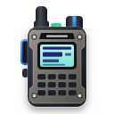

# Kern

**Zero-heap `#![no_std]` microkernel, relocatable app runtime, and desktop companion for handheld amateur radio transceivers.**

[](https://github.com/qshosfw/kern/actions/workflows/ci.yml)
[](https://github.com/qshosfw)
[](https://ko-fi.com/qshosfw)
[](https://www.rust-lang.org/)
[](#supported-hardware)
[](LICENSE)

<sub>
  <a href="#overview">Overview</a> ·
  <a href="#screenshots">Screenshots</a> ·
  <a href="#supported-hardware">Hardware</a> ·
  <a href="#getting-started">Getting Started</a> ·
  <a href="#kern-dock">Kern Dock</a> ·
  <a href="#packages">Packages</a> ·
  <a href="#localization">Localization</a> ·
  <a href="#cli-reference">CLI</a> ·
  <a href="#standards--protocols">Protocols</a> ·
  <a href="#architecture">Architecture</a> ·
  <a href="#writing-apps">Writing Apps</a>
</sub>

<br />


</div>

---

## Overview

Kern is an open-source firmware and tool ecosystem developed by [OpenTaiko (`qshosfw`)](https://github.com/qshosfw) for Cortex-M0+ handheld radios based on the PY32F071xB (128 KB Flash, 16 KB SRAM, 2 MB external SPI Flash), including the **Quansheng UV-K1**, **UV-K5 v3 / UV-K6**, and **K10 Pro**.

Rather than packing every feature into a single monolithic ROM image, Kern keeps the resident microkernel small and moves applications, system utilities, fonts, icons, and translations onto the external 2 MB SPI Flash. Applications run through a single-entry syscall ABI (`kern_call`) with capability checks and zero dynamic heap allocation.

### What is included

- **Microkernel & RF Coordinator (`src/`)** — `#![no_std]` Rust kernel with strict zero-heap execution, RF resource arbitration (`RadioCoordinator`), power-loss-safe SPI Flash storage (`KernFS`), Ascon cryptography, and USB-C / UART remote control (`RigWire`).
- **External Packages (`packages/`)** — 14 relocatable `.krx` / `.mod` packages including the VFO transceiver, Settings, DFU updater, Recovery shell, Multiboot, Crash Inspector, Calibration viewer, System Info, and Rust/C starter templates.
- **Desktop Companion ([`dock/`](dock/README.md))** — Native GTK4 + Libadwaita companion (`./kern dock`) with live 60 FPS LCD streaming, 12 handset and bare-PCB models, PC keyboard and scroll-wheel rotary input, BK4829 DDS-matched headless audio, firmware flasher, backups, colored hex inspector, VTE terminal, and OS filesystem mounting.
- **Cross-Platform Toolchain (`./kern`, `kern.cmd`)** — Unified Linux, macOS, and Windows CLI for building, budget checking, ABI verification, flashing, package building, provisioning, WebDAV mounting, and ELF bloat analysis.
- **Localization (`assets/`)** — 13 interface languages spanning Latin, Cyrillic, Greek, and CJK scripts with compiled binary font, icon, and string packs.

---

## Screenshots

### Kern Dock

Kern Dock streams the radio display over USB-C or UART, mirrors physical controls, and provides file management, backups, hex inspection, flashing, and an embedded terminal.

<div align="center">
  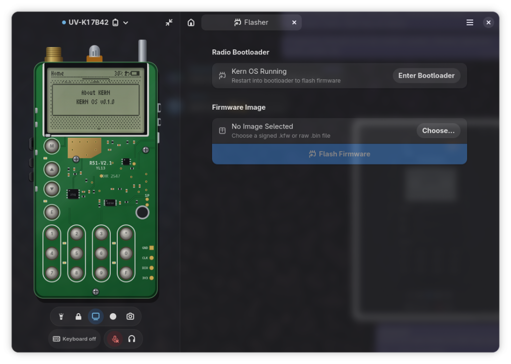
  <br />
  <sub>R51-V2.1 bare PCB bench model alongside the Firmware Flasher tab.</sub>
</div>

<br />

<table>
  <tr>
    <td align="center" width="33%">
      <br />
      <sub><b>UV-K1(8) Metallic</b> — Mini-Dock with live launcher and PC keyboard bridge</sub>
    </td>
    <td align="center" width="33%">
      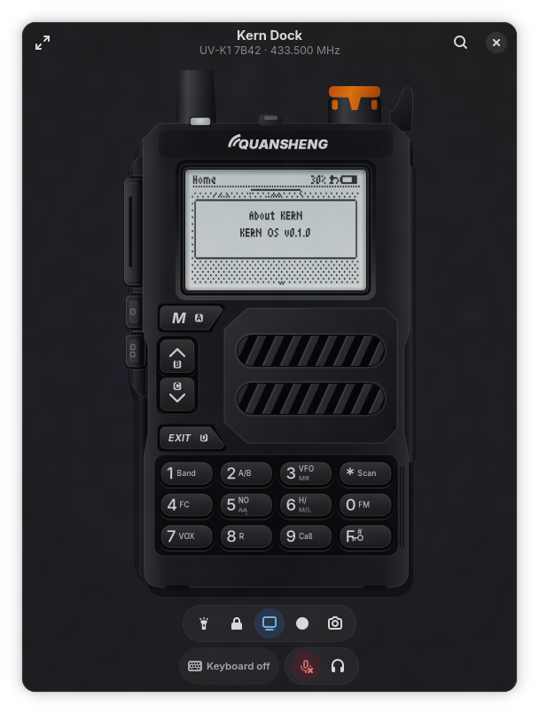<br />
      <sub><b>UV-K5 Diagonal Grille</b> — Mini-Dock in headless mode</sub>
    </td>
    <td align="center" width="33%">
      <br />
      <sub><b>UV-K1 Open Shell</b> — Exposed snap domes and runtime ABI version guard</sub>
    </td>
  </tr>
</table>

### Radio & Launcher

<table>
  <tr>
    <td align="center" width="25%">
      <br />
      <sub>Dual-VFO &amp; S-Meter</sub>
    </td>
    <td align="center" width="25%">
      <br />
      <sub>Step Tuning</sub>
    </td>
    <td align="center" width="25%">
      <br />
      <sub>App Launcher Grid</sub>
    </td>
    <td align="center" width="25%">
      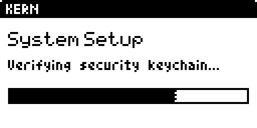<br />
      <sub>First-Boot Setup</sub>
    </td>
  </tr>
</table>

### System Modules (`dfu.mod` & `sysinfo.krx`)

<table>
  <tr>
    <td align="center" width="25%">
      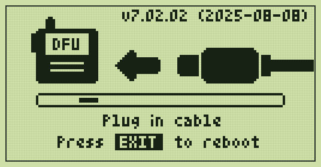<br />
      <sub>DFU Standby</sub>
    </td>
    <td align="center" width="25%">
      <br />
      <sub>DFU USB Ready</sub>
    </td>
    <td align="center" width="25%">
      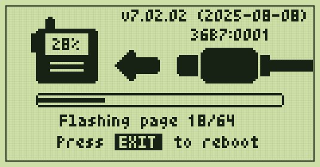<br />
      <sub>DFU Flashing</sub>
    </td>
    <td align="center" width="25%">
      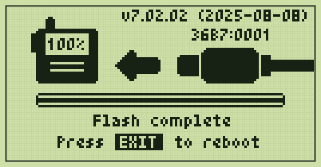<br />
      <sub>DFU Complete</sub>
    </td>
  </tr>
  <tr>
    <td align="center" width="25%">
      <br />
      <sub>Device &amp; OTP Identity</sub>
    </td>
    <td align="center" width="25%">
      <br />
      <sub>MCU &amp; Clocks</sub>
    </td>
    <td align="center" width="25%">
      <br />
      <sub>Battery &amp; Storage</sub>
    </td>
    <td align="center" width="25%">
      <br />
      <sub>Regulatory Marks</sub>
    </td>
  </tr>
</table>

### Localization & Text Input

<div align="center">
  
</div>

<br />

<table>
  <tr>
    <td align="center" width="25%">
      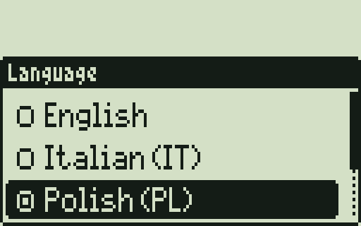<br />
      <sub>Language Picker</sub>
    </td>
    <td align="center" width="25%">
      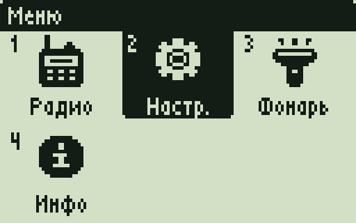<br />
      <sub>Russian Launcher</sub>
    </td>
    <td align="center" width="25%">
      <br />
      <sub>Polish Settings</sub>
    </td>
    <td align="center" width="25%">
      <br />
      <sub>Greek Settings</sub>
    </td>
  </tr>
  <tr>
    <td align="center" width="25%">
      <br />
      <sub>Japanese (日本語)</sub>
    </td>
    <td align="center" width="25%">
      <br />
      <sub>Chinese (中文)</sub>
    </td>
    <td align="center" width="25%">
      <br />
      <sub>Latin Diacritics Input</sub>
    </td>
    <td align="center" width="25%">
      <br />
      <sub>Cyrillic Input</sub>
    </td>
  </tr>
</table>

<details>
<summary>More screenshots (additional locales, Greek text input, DFU settings &amp; SAR info)</summary>

<br />

<table>
  <tr>
    <td align="center" width="25%">
      <br />
      <sub>Italian (Italiano)</sub>
    </td>
    <td align="center" width="25%">
      <br />
      <sub>Ukrainian (Українська)</sub>
    </td>
    <td align="center" width="25%">
      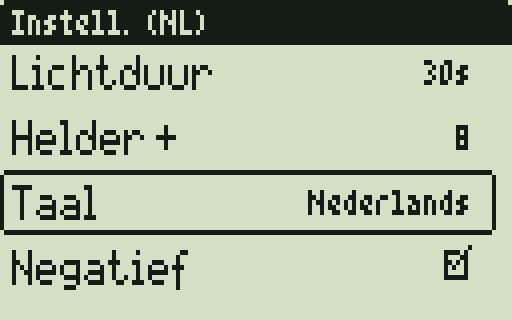<br />
      <sub>Dutch (Nederlands)</sub>
    </td>
    <td align="center" width="25%">
      <br />
      <sub>Portuguese (Português)</sub>
    </td>
  </tr>
  <tr>
    <td align="center" width="25%">
      <br />
      <sub>Russian Settings</sub>
    </td>
    <td align="center" width="25%">
      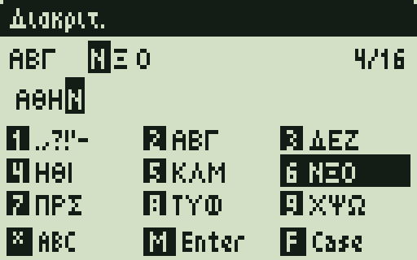<br />
      <sub>Greek Text Input</sub>
    </td>
    <td align="center" width="25%">
      <br />
      <sub>System Modules Menu</sub>
    </td>
    <td align="center" width="25%">
      <br />
      <sub>SAR &amp; Compliance</sub>
    </td>
  </tr>
</table>

</details>

---

## Supported Hardware

| Device | MCU | Internal Flash / SRAM | External SPI Flash | RF &amp; Peripherals | Status |
|---|---|---|---|---|---|
| **Quansheng UV-K1 / UV-K1(8)** | PY32F071xB (Cortex-M0+ @ 48/72 MHz) | 128 KB / 16 KB | PY25Q16 (2 MB) | BK4829, BK1080, ST7565, USB-C | Primary |
| **Quansheng UV-K5 v3 / UV-K6** | PY32F071xB (Cortex-M0+ @ 48/72 MHz) | 128 KB / 16 KB | PY25Q16 (2 MB) | BK4829, BK1080, ST7565, UART/USB | Supported |
| **Quansheng K10 Pro** | PY32F071xB (Cortex-M0+ @ 48/72 MHz) | 128 KB / 16 KB | PY25Q16 (2 MB) | Dual knobs, GNSS / extended IO | Experimental (`target_k10pro`) |
| **QEMU `uv-k5-v3`** | Emulated ARMv6-M | 128 KB / 16 KB | Virtual 2 MB | Virtual LCD, keypad, RigWire TCP | Supported |

---

## Getting Started

### Prerequisites

- **Rust nightly** — pinned via [`rust-toolchain.toml`](rust-toolchain.toml) (`thumbv6m-none-eabi` + `rust-src`)
- **ARM GCC** (`arm-none-eabi-gcc`, `arm-none-eabi-objcopy`) — required for linking `.krx` / `.mod` packages
- **Python 3.11+** — core CLI uses only the standard library; `pyserial` enables hardware serial/USB commands; `PyGObject` (GTK4 + Libadwaita + VTE) enables Kern Dock

Run the environment check first (`./kern` on Linux/macOS, `kern.cmd` on Windows):

```bash
git clone https://github.com/qshosfw/kern.git
cd kern
./kern doctor
```

### Build, Test, and Flash

```bash
# Verify ABI headers, type-check with zero warnings, and run host tests
./kern abi --check
./kern check --deny-warnings
./kern test

# Build release firmware (.bin, packed bootloader image, .kfw, QEMU .elf)
./kern build
./kern size

# Build all userland .krx / .mod packages
./kern pkg all

# Detect connected radios and flash via serial bootloader (hold PTT on power-on)
./kern ports
./kern flash
```

### Provision Packages and Launch Dock

Core apps and system modules live on SPI Flash rather than MCU ROM. Provision them over USB-C or UART once the radio boots:

```bash
# Provision core apps (vfo.krx + settings.krx)
./kern provision --port /dev/ttyACM0 --bundle core

# Provision core apps + system modules (calib, dfu, recovery, panic, sysinfo)
./kern provision --port /dev/ttyACM0 --bundle sys

# Launch Kern Dock (or try without hardware using --demo)
./kern dock
./kern dock --demo
```

### Running Without Hardware (Demo &amp; QEMU)

You can work on the UI, packages, and RigWire tooling without a physical radio:

```bash
# Built-in offline demo radio inside Kern Dock
./kern dock --demo

# Full ARMv6-M QEMU hardware emulator + attach Kern Dock over TCP
./kern emu
./kern dock -p tcp://127.0.0.1:4446
```

### On-Device Shortcuts &amp; Recovery Controls

| Gesture / Key Combo | Where | Action |
|---|---|---|
| Hold `PTT` on power-on | Boot | Enter Stock Serial Bootloader for firmware flashing |
| Hold `MENU + EXIT` (3 s) | Headless Mode | Exit headless mode, wake LCD/backlight, and restore local controls |
| Hold `F` / `#` | Anywhere | Lock or unlock the keypad |
| Hold `EXIT` | Launcher | Enter Deep Sleep (STOP mode); disabled while USB/RigWire or headless is active |
| Hold `EXIT` | Inside an App | Force-close active application and return to Launcher |

---

## Kern Dock

[Kern Dock](dock/README.md) (`./kern dock`) is a standalone GTK4 + Libadwaita desktop companion designed to be **OS-agnostic** while supporting RigWire, KernFS, KRX, KFW, and Kern record tables.

- **12 Handset &amp; Bench Models** — Auto-detected from USB descriptors and RigWire `HELLO` (`k1`, `k1-polymer`, `k1-clear`, `k5v3`, `k5-orange`, `k5-black`, `k5-99`, `k5-99-red`, `uv5r-plus`, `k10-pro`, `k1-naked`, `pcb-r51`), with ST7565 LCD optics (contrast, backlight glow, STN ghosting) and forgiving nearest-button hit-testing.
- **Input Bridge** — PC keyboard control (`Ctrl+K`), direct UTF-8 text entry (`FACET_INPUT_TEXT`), and mouse wheel / touchpad rotary encoder input (`Event::Encoder`).
- **Headless Mode Audio** — Drains RigWire tone rings at 25 ms cadence and synthesizes exact 26 MHz BK4829 DDS sine frequencies (`calc_tone_word`) on the host.
- **Files &amp; Native OS Mounting** — Lazy-loaded KernFS browser plus one-click WebDAV Class 2 mounting into Linux GVFS (POSIX mountpoint), macOS Finder, or Windows Explorer, with `/sys/*` and recovery-module write/delete shields.
- **Apps, Backups, Flasher &amp; Hex Inspector** — Apps manager with 1-bit pixel icons and bounded header reads (`read_head`), `.kfw` / `.zip` / raw 512 B calibration backups, stock bootloader flasher with post-flash reconnect, and a colored Hex + ASCII inspector with live data decoding (`u8/i8/u16/u32/f32/bin/char`).
- **Terminal, Capture &amp; Bridges** — Lazy-spawned embedded `Vte-3.91` shell with `KERN_PORT` / `KERN_MOUNT_PATH`, RigWire console, PNG/GIF capture studio, KISS TNC (`127.0.0.1:8001`), Hamlib `rigctld` (`127.0.0.1:4532`), system tray, `0600` local IPC (`./kern dock ctl`), and a capability-gated plugin API.

```bash
./kern dock                     # Launch GTK4 companion
./kern dock --mini              # Floating handset-only Mini-Dock
./kern dock --headless          # Enable radio headless mode on connect
./kern dock ctl status          # Query running instance over local IPC
./kern dock models              # List all 12 handset and PCB models
./kern dock test                # Run automated headless test suite
```

---

## Packages

Inspect all packages anytime with `./kern pkg --list`. See [`packages/README.md`](packages/README.md) for package details.

### Core Applications (`packages/core/`)

| Package | Output | Profile | Description |
|---|---|---|---|
| [`core/vfo`](packages/core/vfo/krx.toml) | `vfo.krx` | `N1` PIC (Rust) | Dual-VFO transceiver, Dual Watch, Cross-Band, S-meter, rotary tuning |
| [`core/settings`](packages/core/settings/krx.toml) | `settings.krx` | `P0` Paged (Rust) | System Settings (Device, Language, Audio/Rogers/Jingles, Shortcuts, Modules, App Manager) |

### System Modules (`packages/sys/`)

| Package | Output | Profile | Description |
|---|---|---|---|
| [`sys/calib`](packages/sys/calib/krx.toml) | `calib.mod` | `N1` PIC (Rust) | Factory RF and battery calibration viewer (`/sys/calib.dat`) |
| [`sys/dfu`](packages/sys/dfu/README.md) | `dfu.mod` | `P0` Paged | Visual USB-C / UART DFU updater with SRAM quiescing |
| [`sys/recovery`](packages/sys/recovery/README.md) | `recovery.mod` | `P0` Paged | On-device recovery shell and SRAM flasher |
| [`sys/multiboot`](packages/sys/multiboot/README.md) | `multiboot.mod` | `P0` Paged | Multi-slot firmware bootloader manager |
| [`sys/panic`](packages/sys/panic/krx.toml) | `panic.mod` | `P0` Paged | Crash inspector, register dump, Thumb-1 disassembler, QR report |
| [`sys/sysinfo`](packages/sys/sysinfo/README.md) | `sysinfo.krx` | `P0` Paged | Hardware identity, OTP certificate, battery/storage telemetry, legal marks |

### Optional Apps &amp; Templates (`packages/apps/`, `packages/examples/`)

| Package | Output | Profile | Description |
|---|---|---|---|
| `apps/beacon` | `beacon.krx` | `N1` PIC | RF / display beacon utility |
| `apps/bench` | `bench.krx` | `N1` PIC | C-ABI and capability validation bench |
| `examples/hello_rust` | `hello_rust.krx` | `N1` PIC (Rust) | Minimal `#![no_std]` Rust `kern-sdk` starter |
| `examples/hello_c` | `hello_c.krx` | `N1` PIC (C) | Minimal C `sdk/c/krx.h` starter |
| `examples/leaf` | `leaf.krx` | `P0` Paged (C) | Structured 1 KB leaf-chaining template |
| `examples/paged` | `paged.krx` | `P1` Demand-Paged (C) | Transparent demand-paged window cache template |

---

## Localization

Kern supports 13 languages (built-in English plus 12 TOML catalogs under [`assets/lang/`](assets/lang/)) compiled alongside `.fnt` font and `.icn` icon packs via `./kern media`:

| Script | Languages |
|---|---|
| Latin | English (`en`), German (`de`), Spanish (`es`), French (`fr`), Italian (`it`), Dutch (`nl`), Polish (`pl`), Portuguese (`pt`) |
| Cyrillic | Russian (`ru`), Ukrainian (`uk`) |
| Greek | Greek (`el`) |
| CJK | Japanese (`ja`), Chinese (`zh`) |

---

## CLI Reference

All tools share [`tools/cli_ui.py`](tools/cli_ui.py) (`NO_COLOR`, `--no-color`, `--json`, Windows VT100/UTF-8 console support, `stderr` diagnostics, POSIX exit codes). Run `./kern <command> --help` for subcommand options.

| Command | Aliases | Purpose |
|---|---|---|
| `./kern build` | *(default)* | Build release firmware, pack bootloader binary, verify Flash/SRAM budgets |
| `./kern check` | | Fast zero-warning syntax and type check (`--deny-warnings`) |
| `./kern size` | | Flash and SRAM memory section breakdown |
| `./kern info` | `dry-run` | Show target MCU, active feature gates, and resolved budgets |
| `./kern flash` | | Build and flash firmware over serial bootloader |
| `./kern clean` / `distclean` | | Clean Cargo target (`distclean` also removes package &amp; Dock build caches) |
| `./kern test` | | Run host unit test suite across the workspace |
| `./kern fmt` | `format` | Format all Rust code with `rustfmt` |
| `./kern lint` | | Run static architectural linter ([`tools/archlint.py`](tools/archlint.py)) |
| `./kern bloat` | | Run ELF symbol, stack, rodata, and monomorphization analyzer ([`tools/bloat.py`](tools/bloat.py)) |
| `./kern disasm` | | Disassemble compiled Cortex-M0+ release binary |
| `./kern dock` | | Launch Kern Dock desktop companion |
| `./kern wire` | `monitor` | RigWire serial host CLI and file transfer utility |
| `./kern provision` | | Provision `.krx` / `.mod` package bundles over RigWire |
| `./kern mount` | | Mount radio KernFS natively on Linux, macOS, and Windows via WebDAV |
| `./kern ports` | `devices` | List active USB and serial radio ports (`--all`, `--json`) |
| `./kern emu` | | Launch QEMU `uv-k5-v3` emulator and Web UI |
| `./kern pkg` | `packages` | Build or list KRX packages (`--list`, `--json`) |
| `./kern abi` | | Regenerate or check `sdk/c/krx_ops.h` against `src/abi` (`--check`) |
| `./kern kfw` | | Pack, inspect, verify, sign, or extract `.kfw` v1.0 containers |
| `./kern media` | | Compile and inspect `.icn`, `.fnt`, and `.lng` binary media packs |
| `./kern doctor` | | Verify Rust, ARM GCC, Python, GTK4, and OS mount prerequisites (`--json`) |

<details>
<summary>Feature gates in <code>kern.toml</code> (disabled features compile to 0 bytes of Flash)</summary>

- **hardware**: `radio`, `fm_radio`, `uart`, `usb`, `usb_cdc`, `wire`, `usb_msc`, `usb_msc_fat`
- **storage_security**: `filesystem`, `secure_fs`, `passcode`, `app_hibernation`
- **runtime**: `krx_native` (N0/N1/P0), `krx_paged` (P1 demand-paged window cache)
- **display**: `animations`, `grayscale` (2-bit 4-level temporal FRC)
- **diagnostics**: `overclock_72mhz`, `settings_info`, `settings_calib`, `settings_debug`
- **provisioning**: `provision_apps`, `provision_rogers`, `extra_rogers`, `boot_assets`, `boot_jingle`

</details>

---

## Standards &amp; Protocols

### RigWire

COBS-framed binary protocol over USB-C CDC (`36b7:ffff`) or 2-pin UART using `(domain, instance, facet)` resource handles across `SYSTEM (0x00)`, `RADIO (0x01)`, `UI (0x02)`, `INPUT (0x03)`, `CONFIG (0x04)`, `APP (0x05)`, and `STORAGE (0x06)`. Supports strip-delta framebuffer streaming, key/UTF-8/rotary-encoder input injection, headless audio tone draining, and chunked CRC-32 file transfers with bounded header-only reads.

### KernFS &amp; Power-of-Two Record Geometry

Copy-on-write 256-byte page filesystem on SPI Flash. All table structures use exact powers of two ($2^N$) aligned to 4 KB erase sectors so Cortex-M0+ seeking uses a single shift (`offset = 16 + (index << N)`) with no division:

| Path | Header | Record Size | Contents |
|---|---|---|---|
| `/user/channels.ch` | `CHAN` (16 B) | 64 B | Memory channels + 16 B opaque `user_tag` extension slot |
| `/user/contacts.ct` | `CONT` (16 B) | 32 B | Callsigns and contacts |
| `/user/bandplans.bnd` | `BNDP` (16 B) | 32 B | Regional band plans and TX/RX limits |
| `/user/zones.zn` | `ZONE` (16 B) | 32 B | Channel zones |
| `/user/scanner.hit` | `HITS` (16 B) | 32 B | Scanner hits |
| `/user/fm_radio.fm` | `FMBC` (16 B) | 16 B | Broadcast FM presets |
| `/user/vfo_a.vfo`, `vfo_b.vfo` | Composite | 160 B | Two-tier VFO state (instant SRAM updates, idle/power-down writeback) |
| `/pref/*.cfg` | Domain CRC32 | Modular | `display.cfg`, `audio.cfg`, `keys.cfg`, `battery.cfg`, `system.cfg` |
| `/sys/calib.dat`, `calib.sig` | Raw + MAC | 512 B + 32 B | Factory calibration authenticated by Ascon-128 MAC |
| `/apps/*.krx`, `*.mod` | `C0 DE 01 FE` | Relocatable | Installed userland packages and system modules |

### `.kfw` v1.0 Container

Zero-dependency container format ([`tools/kfw.py`](tools/kfw.py)) for firmware images and KernFS backups using Ascon primitives (`Ascon-Hash256`, `Ascon-AEAD128`, `Ascon-128-MAC`, post-quantum `LMS-Ascon`), solid `ARMTHUMB+LZMA2` compression, MCU-streamable `PackBits RLE`, protected bootloader/calibration address fences, and anti-rollback counters.

### Headless Node Mode

For unattended remote sites, junction boxes, digital packet nodes, or desktop RigWire stations (`src/firmware/src/system/headless.rs`):

- Sleeps the LCD, latches backlight dark, turns off the flashlight, and disables the local speaker amplifier (routing tones to the RigWire audio ring).
- Inhibits Deep Sleep / APO and suppresses local sleep hold sheets and low-battery popups.
- Enforces a 5-second TX link-loss failsafe (`enforce_tx_failsafe`).
- Persists across warm resets (`BackupCrashTag::FLAG_HEADLESS`) and power loss (`/pref/keys.cfg`).
- **Physical Escape**: Hold **`MENU + EXIT` simultaneously for 3 seconds** on the radio to exit headless mode and wake the local display.

---

## Architecture

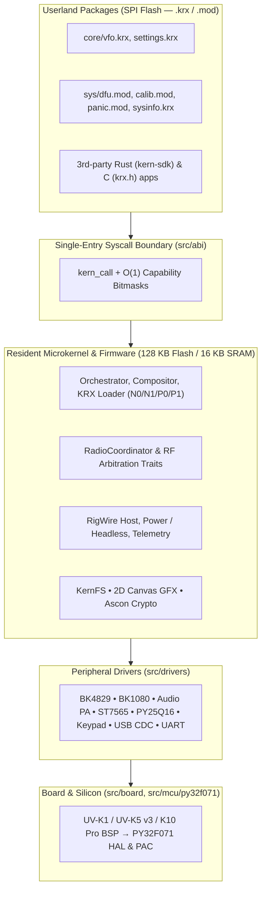

### Memory Budget &amp; Why Packages Live on SPI Flash

| Region | Size | Role |
|---|---|---|
| **MCU Internal Flash** | 128 KB (budget: 118 KB) | Resident microkernel, drivers, KernFS, GFX, RigWire host, KRX loader |
| **MCU Internal SRAM** | 16 KB | Static kernel state, 8 KB relocatable KRX execution arena, call/IRQ stacks |
| **External SPI Flash (`PY25Q16`)** | 2 MB | KernFS storage: `/apps/*.krx`, `/apps/*.mod`, `/user/*`, `/pref/*.cfg`, `/sys/*`, fonts &amp; locales |

Moving applications (`vfo.krx`, `settings.krx`), maintenance tools (`dfu.mod`, `recovery.mod`, `panic.mod`, `sysinfo.krx`, `calib.mod`), fonts, and localization catalogs onto SPI Flash keeps MCU ROM well under the 128 KB ceiling while allowing new apps to be installed or updated over USB-C without reflashing firmware.

### Repository Layout

```text
kern/
├── kern / kern.cmd        # Cross-platform CLI (Linux/macOS + Windows)
├── kern.toml              # Target hardware, Flash/SRAM budgets & feature gates
├── Makefile               # Standard make targets forwarding to ./kern
├── src/                   # Layered #![no_std] Rust workspace
│   ├── abi/               # Syscall opcodes, caps, props & abigen
│   ├── kernel/            # Microkernel contracts (proc, ipc, caps, radio, store, power, wire)
│   ├── fs/                # KernFS copy-on-write SPI Flash filesystem
│   ├── drivers/           # BK4829, BK1080, ST7565, PY25Q16, USB CDC, UART, Audio, Keypad
│   ├── gfx/               # Monochrome/grayscale 2D Canvas, fonts, icons & UI widgets
│   ├── crypto/            # CRC32, Ascon-128 AEAD/MAC, COBS framing, TRNG
│   ├── calib/             # Factory calibration block parsing & curves
│   ├── util/              # Divisionless Cortex-M0+ math, DSP, formatting & path helpers
│   ├── hal-traits/        # Hardware-agnostic peripheral traits
│   ├── board/uv-k1/       # Board support package (pinmux, clocks, UID)
│   ├── mcu/py32f071/      # PY32F071 PAC & HAL
│   └── firmware/          # Resident OS orchestrator, compositor, KRX runtime & RigWire host
├── sdk/                   # Rust (sdk/rust) & C (sdk/c) package SDKs + krx.ld
├── packages/              # External installable .krx / .mod packages
├── assets/                # Fonts, 16×16 pixel icons, 12 TOML locales & i18n captures
├── media/                 # Radio & Kern Dock screenshots
├── dock/                  # Standalone GTK4 + Libadwaita hardware companion
└── tools/                 # cli_ui, kern_cli, builder, flasher, rigwire, kernfs_mount, kfw, bloat, archlint
```

---

## Writing Apps

External packages can be written in Rust (`sdk/rust` — `kern-sdk`) or C (`sdk/c/krx.h` + generated `sdk/c/krx_ops.h`) without touching firmware ROM:

```bash
./kern pkg examples/hello_rust
./kern wire sideload packages/examples/hello_rust/hello_rust.krx --force
```

<details>
<summary>Minimal <code>krx.toml</code> package manifest</summary>

```toml
name = "Hello Rust"
author = "YOUR-CALLSIGN"
version = "1.0.0"
type = "app"              # app | service | daemon | driver | module
profile = "n1"            # n0 | n1 | p0 | p1
root = "main.rs"
output = "hello_rust.krx"
caps = ["DISPLAY", "KEYPAD"]
```

</details>

---

## Safety, Contributing &amp; License

- **RF Safety**: Amateur radio transmitters operate on regulated spectrum. Verify antennas or dummy loads and follow local licensing regulations; see [SAFETY.md](SAFETY.md).
- **Security**: Report vulnerabilities via [SECURITY.md](SECURITY.md).
- **Contributing**: See [CONTRIBUTING.md](CONTRIBUTING.md) and [AGENTS.md](AGENTS.md). Before submitting a pull request:
  ```bash
  ./kern fmt && ./kern abi --check && ./kern check --deny-warnings && ./kern test && ./kern dock build
  ```
- **Support**: Ongoing OpenTaiko hardware and firmware development can be supported on [Ko-fi](https://ko-fi.com/qshosfw).
- **License**: GNU General Public License v3.0 — see [LICENSE](LICENSE) and [COPYING](COPYING).
