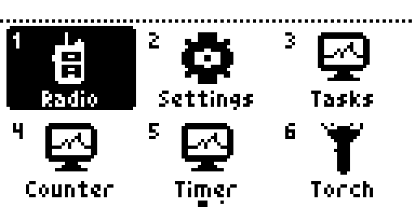
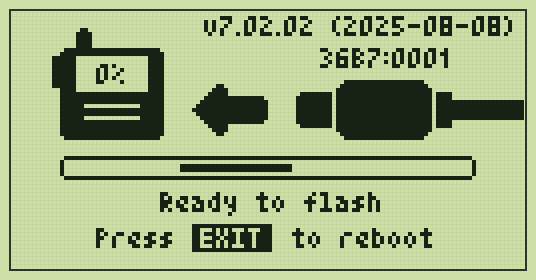
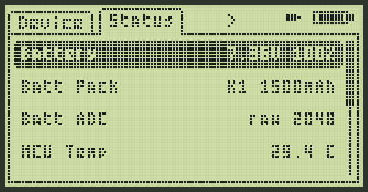
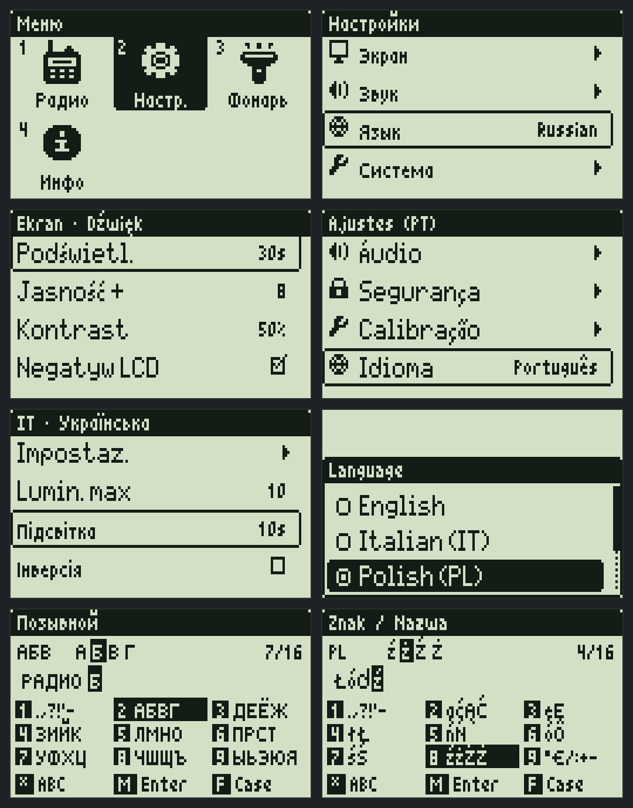
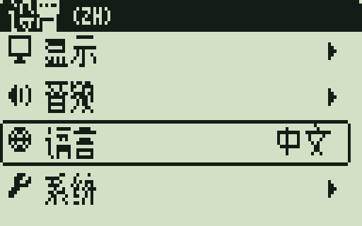
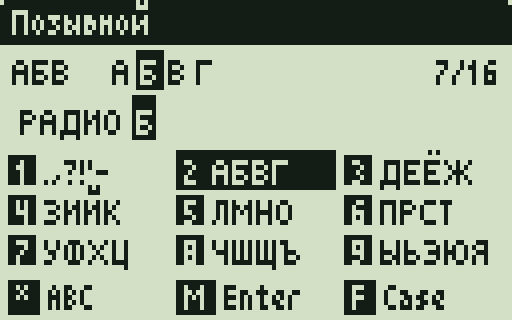
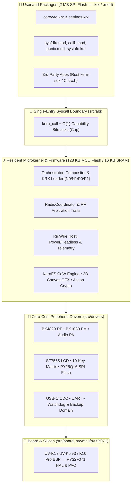

<div align="center">


# ⚡ Kern

### Open-Source Zero-Heap Microkernel, Modular App Platform & Desktop Companion for Amateur Radio Transceivers

*Built by **[OpenTaiko (`qshosfw`)](https://github.com/qshosfw)** — turning affordable Cortex-M0+ handheld radios into a safe, extensible, multilingual, USB-C connected radio platform.*

[](https://github.com/qshosfw/kern/actions/workflows/ci.yml)
[](LICENSE)
[](https://www.rust-lang.org/)
[](#-supported-radios--hardware-matrix)
<br/>
[](#-internationalization--media-packs)
[](#-userland-package-ecosystem-krx--mod)
[](#%EF%B8%8F-kern-dock--desktop-hardware-companion)
[](https://github.com/qshosfw)
[](https://ko-fi.com/qshosfw)

<p>
  <a href="#-what-is-kern">Overview</a> •
  <a href="#-screenshots--visual-showcase">Screenshots</a> •
  <a href="#-supported-radios--hardware-matrix">Hardware</a> •
  <a href="#%EF%B8%8F-kern-dock--desktop-hardware-companion">Kern Dock</a> •
  <a href="#-quick-start">Quick Start</a> •
  <a href="#-userland-package-ecosystem-krx--mod">Packages</a> •
  <a href="#-cli--toolchain-reference">CLI</a> •
  <a href="#-open-standards--protocols">Standards</a> •
  <a href="#%EF%B8%8F-microkernel-architecture">Architecture</a> •
  <a href="#-authoring-your-own-apps">App SDK</a>
</p>

</div>

---

## ✨ What is Kern?

Modern handheld transceivers like the **Quansheng UV-K1** and **UV-K5 v3** pack remarkable RF hardware into a pocket-sized $25 chassis, yet ship with rigid, monolithic firmware trapped inside **128 KB of MCU Flash** and **16 KB of SRAM**.

**Kern** reimagines handheld radio firmware from first principles as a **real microkernel operating system** written in `#![no_std]` Rust — with **zero heap allocation**, **external installable applications** stored on the 2 MB SPI Flash, **13 interface languages** (including Latin, Cyrillic, Greek, and CJK), **native USB-C & RigWire remote control**, **plug-and-play OS filesystem mounting**, and a full **GTK4 desktop companion ([Kern Dock](dock/README.md))**.

> [!TIP]
> **New here?** You don't need physical hardware to try Kern! Launch the built-in interactive demo handset with `./kern dock --demo`, or run the full QEMU hardware emulator with `./kern emu`.

### 🌟 Why Kern Stands Out

| Pillar | What It Gives You |
|---|---|
| 🧠 **Zero-Heap `#![no_std]` Microkernel** | Zero `alloc`, zero `Box`, zero heap fragmentation. Deterministic static budgets on Cortex-M0+ (`128 KB` Flash / `16 KB` SRAM) with sub-30 ms UI response. |
| 📱 **Installable Apps (`.krx` / `.mod`)** | Even core apps (`vfo.krx`, `settings.krx`) and system modules (`dfu.mod`, `calib.mod`, `recovery.mod`, `panic.mod`, `sysinfo.krx`) live on the 2 MB SPI Flash — keeping MCU ROM lean and extensible. |
| 🖥️ **Kern Dock Companion** | Live 60 FPS LCD streaming, 12 photorealistic handset & bare-PCB bench models, PC keyboard + scroll-wheel rotary encoder, BK4829 DDS-accurate headless audio, Flasher, Backups, Colored Hex Inspector & VTE Terminal. |
| 🔌 **RigWire Open Protocol** | Fast COBS-framed USB-C / UART control plane for live screen streaming, telemetry, tuning, package sideloading, KISS TNC, Hamlib `rigctld`, and unattended headless nodes. |
| 📂 **Power-Loss-Safe `KernFS` + WebDAV Mount** | Copy-on-write 256 B page-granular SPI Flash filesystem mountable as a native drive on **Linux, macOS, and Windows** with zero kernel drivers (`./kern mount`). |
| 🌍 **13 Languages & Rich Pixel Typography** | Native localization across Latin, Cyrillic, Greek, Japanese, and Chinese scripts with compiled `.fnt`, `.icn`, and `.lng` media packs. |
| 🔐 **Ascon Cryptography & Anti-Brick Shields** | Hardware-authenticated factory calibration (`/sys/calib.dat` + Ascon-128 MAC), `.kfw` v1.0 containers with post-quantum `LMS-Ascon` signatures, and protected bootloader/calibration fences. |
| 📡 **Unattended Headless Node Mode** | Run a radio silently in a junction box, mast, or desktop RigWire station — LCD/backlight/flashlight off, local speaker muted with PC tone routing, 5 s TX link-loss failsafe, and a deliberate `MENU + EXIT` (3 s) physical escape combo. |

---

## 📸 Screenshots & Visual Showcase

### 📻 Core Radio UI & App Launcher

<table>
  <tr>
    <td align="center" width="25%">
      <br/>
      <sub><b>Dual-VFO Transceiver</b><br/>Dual Watch, S-Meter &amp; Uptime</sub>
    </td>
    <td align="center" width="25%">
      <br/>
      <sub><b>Responsive Step Tuning</b><br/>Instant VFO &amp; Rotary Control</sub>
    </td>
    <td align="center" width="25%">
      <br/>
      <sub><b>App Launcher Grid</b><br/>16×16 Pixel Icons from KRX Assets</sub>
    </td>
    <td align="center" width="25%">
      <br/>
      <sub><b>First-Boot Setup</b><br/>Clean Hardware Bring-Up</sub>
    </td>
  </tr>
</table>

### 🛠️ External System Modules (`dfu.mod` & `sysinfo.krx`)

<table>
  <tr>
    <td align="center" width="25%">
      <br/>
      <sub><b>DFU Updater Ready</b><br/>External <code>dfu.mod</code></sub>
    </td>
    <td align="center" width="25%">
      <br/>
      <sub><b>Live Flash Progress</b><br/>SRAM Quiesced Programming</sub>
    </td>
    <td align="center" width="25%">
      <br/>
      <sub><b>Device Identity &amp; OTP</b><br/>External <code>sysinfo.krx</code></sub>
    </td>
    <td align="center" width="25%">
      <br/>
      <sub><b>Power &amp; Storage Health</b><br/>Battery, Clock &amp; KernFS</sub>
    </td>
  </tr>
</table>

### 🌍 Multilingual Interface (13 Languages & Scripts)

<div align="center">
  
</div>

<table>
  <tr>
    <td align="center" width="25%">
      <br/>
      <sub><b>Native Language Picker</b></sub>
    </td>
    <td align="center" width="25%">
      <br/>
      <sub><b>Japanese (日本語)</b></sub>
    </td>
    <td align="center" width="25%">
      <br/>
      <sub><b>Chinese (中文)</b></sub>
    </td>
    <td align="center" width="25%">
      <br/>
      <sub><b>Cyrillic T9 &amp; Direct Input</b></sub>
    </td>
  </tr>
</table>

---

## 📻 Supported Radios & Hardware Matrix

| Target | MCU & Clock | Internal Memory | External Flash | RF / Peripherals | Status |
|---|---|---|---|---|---|
| **Quansheng UV-K1 / UV-K1(8)** | PY32F071xB (Cortex-M0+ @ 48 / 72 MHz) | 128 KB Flash / 16 KB SRAM | PY25Q16 (2 MB SPI) | BK4829, BK1080, ST7565, Native USB-C | 🟢 **Primary Target** |
| **Quansheng UV-K5 v3 / UV-K6** | PY32F071xB (Cortex-M0+ @ 48 / 72 MHz) | 128 KB Flash / 16 KB SRAM | PY25Q16 (2 MB SPI) | BK4829, BK1080, ST7565, UART / USB | 🟢 **Supported (HW + QEMU)** |
| **Quansheng K10 Pro** | PY32F071xB (Cortex-M0+ @ 48 / 72 MHz) | 128 KB Flash / 16 KB SRAM | PY25Q16 (2 MB SPI) | Dual Knobs, GNSS / Extended IO | 🟡 **Experimental (`target_k10pro`)** |
| **QEMU `uv-k5-v3` Emulator** | Emulated ARMv6-M | 128 KB Flash / 16 KB SRAM | Virtual 2 MB SPI | Virtual LCD, Keypad, RigWire TCP | 🟢 **CI & Dev Target** |

> [!NOTE]
> Kern is architected to be **target-agnostic**: hardware capabilities (broad-band HF receivers like Si4732, 10 W PA stages, GNSS telemetry, BLE serial, color RGB panels) are queried via $O(1)$ capability bitmasks (`ctx.has_cap(Cap::...)`) and declarative `PeripheralDescriptor` drivers.

---

## 🖥️ Kern Dock — Desktop Hardware Companion

[**Kern Dock**](dock/README.md) (`./kern dock`) is a standalone, **OS-agnostic** native **GTK4 + Libadwaita 1.8** companion built for any radio speaking **RigWire** and open Kern standards (`KernFS`, `KRX`, `KFW`, Kern Tables).

### Key Capabilities
- **🎨 12 Photorealistic Handset & Developer Bench Models**: Auto-detected from USB descriptors & RigWire `HELLO`, with forgiving nearest-button hit-testing and authentic ST7565 128×64 LCD optics (contrast, backlight glow, asymmetric STN ghosting, 1.3× pixel aspect).
- **⌨️ Unified PC Keyboard & Rotary Scroll Wheel**: Control radio buttons from your PC keyboard (`Ctrl+K`), type directly into on-device text fields (`FACET_INPUT_TEXT`), and use your **mouse wheel or two-finger touchpad** as a smooth rotary encoder (`Event::Encoder`).
- **🔊 BK4829 DDS-Accurate Headless Audio**: In Headless Mode, system tones and melodies stream over RigWire and synthesize on your PC using the exact 26 MHz BK4829 DDS frequency word formula (`calc_tone_word`) with pure fundamental sine waves and crisp 1.5 ms envelopes.
- **📁 Native OS Filesystem Mounting**: One-click non-blocking WebDAV Class 2 mount directly into **GNOME Files / Dolphin** (Linux GVFS POSIX path), **Finder** (macOS), or **File Explorer** (Windows), with anti-brick `/sys/*` and recovery-module shields.
- **🧩 Full Tabbed Workbench**:
  - **Home** — Device status hero, battery/link/VFO/uptime tiles, safety & power controls, tool launcher.
  - **Radio** — Live VFO A/B frequency card with scroll/step buttons, S-meter, modulation, squelch, keyboard bridge.
  - **Files** — Lazy-loaded KernFS browser, pathbar, search (`Ctrl+F`), drag-and-drop upload, inline Mounted Drive bar.
  - **Flasher** — Pre-flight `.kfw`/`.bin` verifier, stock bootloader flasher, automatic post-flash reconnect.
  - **Apps** — Install, inspect, and uninstall radio applications with **authentic 1-bit pixel-art icons** and zero-lag bounded header reads (`read_head`).
  - **Backups** — Create, inspect, extract, and restore `.kfw` (Ascon-Hash256), `.zip` (with `manifest.json`), and raw 512 B calibration snapshots.
  - **Pro Colored Hex Inspector** — Byte-class color highlighting, Kern table record-stride shading, live cursor data decoder (`u8/i8/u16/u32/f32/bin/char`), offset jump, and search.
  - **Terminal** — Lazy-spawned embedded GTK4 `Vte-3.91` shell preloaded with `KERN_PORT` / `KERN_VOLUME` / `KERN_MOUNT_PATH`, plus interactive RigWire command console.
  - **Capture Studio** — Instant PNG snapshots and non-destructive GIF timeline recorder/trimmer/splicer.
- **🌐 Ham Radio Bridges & Automation**: Built-in **KISS TNC** (`127.0.0.1:8001`), **Hamlib `rigctld`** (`127.0.0.1:4532`), native OS System Tray (`StatusNotifierItem`), `0600` local IPC (`./kern dock ctl`), and a capability-gated plugin system.

<details>
<summary><b>📱 View all 12 built-in Kern Dock handset &amp; developer bench models</b></summary>

| Model ID | Display Name | Chassis Style | Default LCD Palette | Notes |
|---|---|---|---|---|
| `k1` | Quansheng UV-K1(8) | `k1-metal` | `UV-K1` | Metallic armor · Blue trim |
| `k1-polymer` | Quansheng UV-K1 Matte Black | `k1-polymer` | `UV-K1` | Matte polymer · Mini Kong |
| `k1-clear` | Quansheng UV-K1(8) Transparent | `k1-clear` | `Ice White` | Clear shell · Visible green PCB |
| `k5v3` | Quansheng UV-K5 v3 / UV-K6 | `k5v3` | `UV-K5` | Brushed silver · Amber LCD |
| `k5-orange` | Quansheng UV-K5(8) Safety Orange | `k5v3` | `UV-5R Blue` | Safety orange · Blue LCD |
| `k5-black` | Quansheng UV-K5 Diagonal Grille | `k5-black` | `Ice White` | Matte black · White LCD |
| `k5-99` | Quansheng UV-K5(99) Charcoal | `k5-99` | `UV-K5` | Charcoal armor · 4-slat grille |
| `k5-99-red` | Quansheng UV-K5(99) Red | `k5-99` | `UV-K5` | Crimson armor · 4-slat grille |
| `uv5r-plus` | Quansheng UV-5R Plus | `uv5r-plus` | `UV-5R Blue` | Blue LCD · Dot grille |
| `k10-pro` | Quansheng UV-K10 Pro | `k10-pro` | `K10 Warm` | Dual knobs · Warm LCD |
| `k1-naked` | Quansheng UV-K1 Open Shell | `k1-naked` | `UV-K1` | No cover · Snap domes |
| `pcb-r51` | R51-V2.1 Bare PCB | `pcb-r51` | `Classic Green` | Bare emerald PCB · SWD pads |

</details>

---

## 🚀 Quick Start

### 1. Check Your Environment (Linux, macOS, Windows)

Clone the repository and run the built-in toolchain doctor (`./kern` on Linux/macOS, `kern.cmd` on Windows):

```bash
git clone https://github.com/qshosfw/kern.git
cd kern
./kern doctor
```

**Prerequisites:**
- **Rust nightly** — automatically selected by [`rust-toolchain.toml`](rust-toolchain.toml) (`thumbv6m-none-eabi` + `rust-src`)
- **ARM GCC (`arm-none-eabi-gcc` / `binutils`)** — for linking `.krx` / `.mod` userland packages
- **Python 3.11+** — stdlib-only core CLI; optional `pyserial` for hardware I/O and `PyGObject` (`gtk4` + `libadwaita`) for Kern Dock

### 2. Build, Verify & Test Firmware

```bash
# Verify Rust ABI matches C SDK header (sdk/c/krx_ops.h)
./kern abi --check

# Fast zero-warning type check & host unit test suite
./kern check --deny-warnings
./kern test

# Compile release firmware (.bin, bootloader packed image, .kfw, QEMU .elf)
./kern build
./kern size
```

### 3. Flash Firmware & Provision Apps

```bash
# List connected USB-C / serial radios
./kern ports

# Flash firmware over serial bootloader (hold PTT while powering on)
./kern flash

# Build all 14 external userland packages (.krx / .mod)
./kern pkg all

# Provision core apps (vfo.krx + settings.krx) or full system bundle over RigWire
./kern provision --port /dev/ttyACM0 --bundle core
./kern provision --port /dev/ttyACM0 --bundle sys

# Launch Kern Dock (or test offline with --demo)
./kern dock
./kern dock --demo
```

---

## 📱 Userland Package Ecosystem (`.krx` / `.mod`)

Kern keeps MCU ROM lean by moving applications and maintenance utilities onto the 2 MB SPI Flash as relocatable **KRX** executables with embedded icons (`SECTION_ASSETS`), capability manifests, and fault isolation. Inspect all packages anytime with `./kern pkg --list`.

### Core Applications (`packages/core/`)
| Package | Binary | Profile | Description |
|---|---|---|---|
| [`core/vfo`](packages/core/vfo/krx.toml) | `vfo.krx` | `N1` PIC (Rust) | Dual-VFO radio transceiver HUD, Dual Watch, Cross-Band, S-meter, rotary tuning |
| [`core/settings`](packages/core/settings/krx.toml) | `settings.krx` | `P0` Paged (Rust, 17 leaves) | Full System Settings: Device identity, Language, Audio/Rogers/Jingles, Shortcuts, Modules & App Manager |

### System & Maintenance Modules (`packages/sys/`)
| Package | Binary | Profile | Description |
|---|---|---|---|
| [`sys/calib`](packages/sys/calib/krx.toml) | `calib.mod` | `N1` PIC (Rust) | Factory RF & battery calibration inspector (`/sys/calib.dat`) |
| [`sys/dfu`](packages/sys/dfu/README.md) | `dfu.mod` | `P0` Paged | Visual USB-C / UART DFU firmware updater with SRAM quiescing |
| [`sys/recovery`](packages/sys/recovery/README.md) | `recovery.mod` | `P0` Paged | On-device safe recovery shell and SRAM flasher |
| [`sys/multiboot`](packages/sys/multiboot/README.md) | `multiboot.mod` | `P0` Paged | Multi-slot firmware & bootloader manager |
| [`sys/panic`](packages/sys/panic/krx.toml) | `panic.mod` | `P0` Paged | Post-mortem crash inspector, register dump, Thumb-1 disassembler & QR report |
| [`sys/sysinfo`](packages/sys/sysinfo/README.md) | `sysinfo.krx` | `P0` Paged | Hardware telemetry, OTP certificate, battery/storage stats & regulatory marks |

### Optional Apps & Contributor Templates (`packages/apps/`, `packages/examples/`)
| Package | Binary | Profile | Description |
|---|---|---|---|
| `apps/beacon` | `beacon.krx` | `N1` PIC | RF / display beacon utility |
| `apps/bench` | `bench.krx` | `N1` PIC | C-ABI & capability validation benchmark suite |
| `examples/hello_rust` | `hello_rust.krx` | `N1` PIC (Rust) | Minimal `#![no_std]` Rust `kern-sdk` starter app |
| `examples/hello_c` | `hello_c.krx` | `N1` PIC (C) | Minimal C `sdk/c/krx.h` starter app |
| `examples/leaf` | `leaf.krx` | `P0` Paged (C) | Structured leaf-chaining template (for apps > 8 KB) |
| `examples/paged` | `paged.krx` | `P1` Demand-Paged (C) | Transparent demand-paged window cache template |

> [!NOTE]
> **KRX Execution Profiles:** `N0`/`N1` execute position-independent Thumb-1 code directly in the 8 KB app arena; `P0` chains structured 1 KB leaves on demand; `P1` transparently demand-pages larger binaries through a ~1.1 KB Flash window cache.

---

## 🌍 Internationalization & Media Packs

Kern ships with **13 languages** (built-in English plus 12 compiled TOML catalogs in [`assets/lang/`](assets/lang/)) rendered via compact binary font (`.fnt`), icon (`.icn`), and language (`.lng`) packs compiled by `./kern media`:

| Script Family | Included Languages |
|---|---|
| **Latin** | English (`en`), German (`de`), Spanish (`es`), French (`fr`), Italian (`it`), Dutch (`nl`), Polish (`pl`), Portuguese (`pt`) |
| **Cyrillic** | Russian (`ru`), Ukrainian (`uk`) |
| **Greek** | Greek (`el`) |
| **CJK** | Japanese (`ja`), Chinese (`zh`) |

```bash
# Inspect or validate compiled font, icon & localization packs
./kern media --help
./kern media check-lang --help
```

---

## 🛠️ CLI & Toolchain Reference

The unified cross-platform CLI (`./kern` on Linux/macOS, `kern.cmd` on Windows, backed by [`tools/kern_cli.py`](tools/kern_cli.py) and [`tools/cli_ui.py`](tools/cli_ui.py)) follows `clig.dev` & `no-color.org` conventions (`NO_COLOR`, `--no-color`, `--json`, Windows VT100/UTF-8, clean exit codes, and typo hints).

| Category | Command | Aliases | Description |
|---|---|---|---|
| **Build** | `./kern build` | *(default)* | Compile release firmware, pack bootloader image & verify Flash/SRAM budgets |
| | `./kern check` | | Fast zero-warning syntax & type check (`--deny-warnings`) |
| | `./kern size` | | Detailed Flash & SRAM section memory breakdown |
| | `./kern info` | `dry-run` | Show target MCU, active feature gates & resolved budgets |
| | `./kern flash` | | Build and flash firmware via serial bootloader |
| | `./kern clean` / `distclean` | | Clean Cargo target (`distclean` also cleans package & Dock build caches) |
| **Quality** | `./kern test` | | Run native host unit test suite across all workspace crates |
| | `./kern fmt` | `format` | Format all Rust code with `rustfmt` |
| | `./kern lint` | | Run heuristic architectural linter ([`tools/archlint.py`](tools/archlint.py)) |
| | `./kern bloat` | | Run ELF symbol, stack, rodata & monomorphization bloat analyzer ([`tools/bloat.py`](tools/bloat.py)) |
| | `./kern disasm` | | Disassemble compiled Cortex-M0+ release binary |
| **Device** | `./kern dock` | | Launch GTK4 + Libadwaita hardware companion (`--demo`, `--mini`, `ctl`, `models`, `test`) |
| | `./kern wire` | `monitor` | RigWire serial host tool, telemetry & file transfer CLI |
| | `./kern provision` | | Provision `.krx`/`.mod` package bundles over RigWire (`--bundle core\|sys\|all`) |
| | `./kern mount` | | Mount radio `KernFS` natively on Linux/macOS/Windows via hardened WebDAV Class 2 |
| | `./kern ports` | `devices` | List active USB & serial radio ports (`--all`, `--json`) |
| | `./kern emu` | | Launch QEMU `uv-k5-v3` emulator & interactive Web UI |
| **Packages** | `./kern pkg` | `packages` | Build or list KRX packages (`--list`, `--json`, `./kern pkg settings`) |
| | `./kern abi` | | Regenerate or verify `sdk/c/krx_ops.h` from `src/abi` (`--check`) |
| | `./kern kfw` | | Pack, inspect, verify, sign (Ascon / LMS-Ascon), or extract `.kfw` v1.0 containers |
| | `./kern media` | | Compile & inspect `.icn` / `.fnt` / `.lng` binary media packs |
| **Health** | `./kern doctor` | | Verify Rust, ARM GCC, Python, GTK4 & OS mount prerequisites (`--json`) |

<details>
<summary><b>⚙️ Declarative Feature Gates (<code>kern.toml</code>) — Zero Flash Cost When Disabled</b></summary>

Every subsystem in [`kern.toml`](kern.toml) compiles to **0 bytes of Flash** when disabled:

- **`hardware`**: `radio` (BK4829), `fm_radio` (BK1080), `uart`, `usb`, `usb_cdc`, `wire` (RigWire), `usb_msc`, `usb_msc_fat`
- **`storage_security`**: `filesystem` (KernFS), `secure_fs` (Ascon-128), `passcode` (Boot PIN KDF), `app_hibernation`
- **`runtime`**: `krx_native` (N0/N1/P0), `krx_paged` (P1 demand-paged window cache)
- **`display`**: `animations` (60–90 Hz kinetic scrolling), `grayscale` (2-bit 4-level temporal FRC)
- **`diagnostics`**: `overclock_72mhz`, `settings_info`, `settings_calib`, `settings_debug`
- **`provisioning`**: `provision_apps`, `provision_rogers`, `extra_rogers`, `boot_assets`, `boot_jingle`

</details>

---

## 🔌 Open Standards & Protocols

Kern is built around clean, documented, OS-agnostic protocols and binary formats so external tools, custom firmwares, and community scripts interoperate seamlessly.

### 1. RigWire Binary Control Plane (`src/kernel/src/wire/`, `tools/rigwire.py`)
COBS-framed binary protocol running over USB-C CDC (`36b7:ffff`) or 2-pin UART with CRC verification and unified resource handles (`(domain, instance, facet)`):
- **Domains**: `SYSTEM (0x00)`, `RADIO (0x01)`, `UI (0x02)`, `INPUT (0x03)`, `CONFIG (0x04)`, `APP (0x05)`, `STORAGE (0x06)`.
- **Real-Time I/O**: Strip-delta 128×64 framebuffer streaming, keypad injection (`FACET_INPUT_KEY`), direct UTF-8 text injection (`FACET_INPUT_TEXT`), rotary encoder detents (`FACET_INPUT_ENCODER`), and headless audio tone ring draining (`FACET_SYS_AUDIO`).
- **Chunked File Transfers**: Streaming `TRANSFER_OPEN` / `TRANSFER_CHUNK` / `TRANSFER_CLOSE` with bounded header-only reads and CRC-32 write verification.

### 2. `KernFS` & $O(1)$ Power-of-Two Storage Geometry (`src/fs/`)
Direct, flat, copy-on-write 256-byte page storage on SPI Flash — zero archive wrappers, zero division instructions on Cortex-M0+ (`offset = 16 + (index << N)`), aligned cleanly to 4 KB erase sectors:

| Path | Header ID | Record Stride | Purpose |
|---|---|---|---|
| `/user/channels.ch` | `CHAN` (16 B) | `64 B` ($2^6$) | Memory channels + 16 B opaque `user_tag` app extension slot |
| `/user/contacts.ct` | `CONT` (16 B) | `32 B` ($2^5$) | Callsigns & directory contacts |
| `/user/bandplans.bnd` | `BNDP` (16 B) | `32 B` ($2^5$) | Regional TX/RX band plans & limits |
| `/user/zones.zn` | `ZONE` (16 B) | `32 B` ($2^5$) | Channel zone groupings |
| `/user/scanner.hit` | `HITS` (16 B) | `32 B` ($2^5$) | Logged frequency scanner hits |
| `/user/fm_radio.fm` | `FMBC` (16 B) | `16 B` ($2^4$) | Broadcast FM station presets |
| `/user/vfo_a.vfo`, `vfo_b.vfo` | Composite | `160 B` | Two-tier VFO state (instant SRAM updates, idle/power-down persistence) |
| `/pref/*.cfg` | Domain CRC32 | Modular | Independent `display.cfg`, `audio.cfg`, `keys.cfg`, `battery.cfg`, `system.cfg` |
| `/sys/calib.dat`, `calib.sig` | Raw + MAC | `512 B` + `32 B` | Factory calibration authenticated via hardware-bound Ascon-128 MAC |
| `/apps/*.krx`, `*.mod` | `C0 DE 01 FE` | Relocatable | Installed userland applications & system modules |

### 3. `.kfw` v1.0 Container & Ascon Cryptography (`tools/kfw.py`, `src/crypto/`)
Zero-dependency container format supporting firmware updates, multi-target bundles, and verified KernFS snapshots:
- **100% Ascon Primitives**: `Ascon-Hash256`, `Ascon-AEAD128`, `Ascon-128-MAC`, and post-quantum **`LMS-Ascon`** signatures.
- **Compression**: Solid `ARMTHUMB+LZMA2` (~41% universal multi-target size) plus MCU-streamable `None` and `PackBits RLE` codecs.
- **Anti-Brick Guards**: Target verification, protected bootloader & calibration address fences, ARMv6-M vector checks, and anti-rollback `sec_cnt`.

### 4. Unattended Headless Node Mode (`src/firmware/src/system/headless.rs`)
Purpose-built for remote mast sites, junction boxes, digital packet/APRS nodes, and desktop USB-C rigs:
- Latches the LCD in sleep, holds the backlight dark, forces the flashlight off, and disables the local speaker amplifier (routing tones over RigWire).
- Inhibits Deep Sleep / APO and suppresses local on-screen sleep prompts and low-battery modal popups.
- Protects unattended transmitters with a **5-second RigWire TX link-loss failsafe** (`enforce_tx_failsafe`).
- Survives warm resets (`BackupCrashTag::FLAG_HEADLESS`) and power loss (`/pref/keys.cfg`).
- **Physical Escape Combo**: Hold **`MENU + EXIT` simultaneously for 3 seconds** on the physical radio at any time to cleanly exit headless mode, wake the LCD & backlight, and resume local operation.

---

## 🏗️ Microkernel Architecture

Kern enforces strict layered decoupling from bare-metal silicon up to userland `.krx` applications:



### The 8 Core Engineering Principles
1. **Abstracted** — Apps never touch hardware registers; all RF, display, and storage operations route through microkernel contracts (`RfChannel`, `RfTuning`, `Canvas`, `KernFS`).
2. **Lightweight** — Strict `#![no_std]` zero heap allocation, static dispatch in hot paths, and 0-byte disabled Cargo features.
3. **Efficient** — Divisionless Cortex-M0+ math, $2^N$ record geometries aligned to 4 KB erase sectors, and zero-copy `#[repr(C, packed)]` structures.
4. **Modular** — Independent subsystems and CRC32-protected `/pref/*.cfg` configuration domains.
5. **Flexible** — Target-agnostic BSPs, dynamic `ModulationProfile` arbitration, and multi-bus driver descriptors (`Internal`, `I2c`, `Spi`, `Uart`, `Usb`).
6. **Extensible** — 16-byte opaque `user_tag` app slots in core tables, declarative driver registries, and capability-checked `.krx` bundles.
7. **Elegant** — Zero compiler warnings, standard systems identifiers (`FILE_ID_*`, `TABLE_ID_*`), and no compatibility shims.
8. **KISS** — Direct, sensible designs without over-engineered indirection.

### Repository Layout

```text
kern/
├── kern / kern.cmd        # Cross-platform CLI (Linux/macOS + Windows)
├── kern.toml              # Declarative hardware target, budgets & feature gates
├── Makefile               # Standard make shortcuts mirroring ./kern
├── src/                   # Layered #![no_std] Rust workspace
│   ├── abi/               # Single-source-of-truth syscall opcodes, caps, props & abigen
│   ├── kernel/            # Microkernel contracts (proc, ipc, caps, radio, store, power, wire)
│   ├── fs/                # KernFS copy-on-write 256 B page SPI Flash filesystem
│   ├── drivers/           # BK4829, BK1080, ST7565, PY25Q16, USB CDC, UART, Audio, Keypad
│   ├── gfx/               # Monochrome/grayscale 2D Canvas, fonts, pixel icons & UI widgets
│   ├── crypto/            # CRC32, Ascon-128 AEAD/MAC, COBS framing, TRNG
│   ├── calib/             # Factory calibration parsing & RF/battery curves
│   ├── util/              # Divisionless Cortex-M0+ math, DSP, formatting & path helpers
│   ├── hal-traits/        # Hardware-agnostic peripheral traits
│   ├── board/uv-k1/       # Board support package (pinmux, clocks, UID, hardware variants)
│   ├── mcu/py32f071/      # PY32F071 PAC & HAL
│   └── firmware/          # Resident OS orchestrator, compositor, KRX runtime & RigWire host
├── sdk/                   # Package author SDKs
│   ├── rust/              # kern-sdk (Rust #![no_std] PIC package SDK)
│   ├── c/                 # krx.h & generated krx_ops.h (C N1/P0/P1 package SDK)
│   └── krx.ld             # Position-independent ARM Thumb-1 linker script
├── packages/              # External installable userland packages
│   ├── core/              # vfo.krx, settings.krx
│   ├── sys/               # calib.mod, dfu.mod, recovery.mod, multiboot.mod, panic.mod, sysinfo.krx
│   ├── apps/              # beacon.krx, bench.krx
│   └── examples/          # hello_rust, hello_c, leaf (P0), paged (P1) starter templates
├── assets/                # Pixel fonts, 16×16 icon catalogs, 12 TOML locales & screenshots
├── dock/                  # Standalone GTK4 + Libadwaita hardware companion (./kern dock)
└── tools/                 # cli_ui, kern_cli, builder, flasher, rigwire, kernfs_mount, kfw, bloat, archlint
```

---

## 👩‍💻 Authoring Your Own Apps

Write external radio apps in **Rust** (`sdk/rust` — `kern-sdk`) or **C** (`sdk/c/krx.h`) without recompiling firmware ROM. Start from any template in [`packages/README.md`](packages/README.md):

```bash
# Build the Rust starter template and sideload it directly over USB-C / UART
./kern pkg examples/hello_rust
./kern wire sideload packages/examples/hello_rust/hello_rust.krx --force

# Or build the C starter template
./kern pkg examples/hello_c
./kern wire sideload packages/examples/hello_c/hello_c.krx --force
```

<details>
<summary><b>📄 Example <code>krx.toml</code> package manifest</b></summary>

```toml
name = "Hello Rust"
author = "YOUR-CALLSIGN"
version = "1.0.0"
type = "app"              # app | service | daemon | driver | module
profile = "n1"            # n0 | n1 (PIC) | p0 (leaves) | p1 (demand-paged)
root = "main.rs"
output = "hello_rust.krx"
caps = ["DISPLAY", "KEYPAD"]
```

</details>

---

## 🛡️ Safety, Security, Contributing & Community

> [!CAUTION]
> **RF & Transmitter Safety:** Amateur radio transmitters operate on regulated spectrum and can cause harmful interference or hardware damage if misconfigured. Always verify antennas/dummy loads and comply with your local licensing regulations. Read [**SAFETY.md**](SAFETY.md) before transmitting.

- **Security Policy**: Report vulnerabilities responsibly via [**SECURITY.md**](SECURITY.md).
- **Contributing**: Read [**CONTRIBUTING.md**](CONTRIBUTING.md) and [**AGENTS.md**](AGENTS.md) for zero-heap invariants, coding standards, and Conventional Commit guidelines. Before opening a PR, run:
  ```bash
  ./kern fmt && ./kern abi --check && ./kern check --deny-warnings && ./kern test && ./kern dock build
  ```

### 💖 Support OpenTaiko (`qshosfw`)

Kern is part of the **[OpenTaiko](https://github.com/qshosfw)** open-source amateur radio ecosystem. If Kern or Kern Dock helps your station, workbench, or hardware hacking, consider supporting ongoing research and development:

<div align="center">

[](https://ko-fi.com/qshosfw)

</div>

---

## 📄 License

Licensed under the **GNU General Public License v3.0** — see [**LICENSE**](LICENSE) and [**COPYING**](COPYING) for full terms.
