<div align="center">


# Kern

**Zero-heap `#![no_std]` microkernel, relocatable app runtime, and desktop companion for handheld amateur radio transceivers.**

[](https://github.com/qshosfw/kern/actions/workflows/ci.yml)
[](https://github.com/qshosfw)
[](https://ko-fi.com/qshosfw)
[](https://www.rust-lang.org/)
[](#supported-hardware)
[](LICENSE)

<sub>
  <a href="#overview">Overview</a> ·
  <a href="#screenshots">Screenshots</a> ·
  <a href="#supported-hardware">Hardware</a> ·
  <a href="#getting-started">Getting Started</a> ·
  <a href="#kern-dock">Kern Dock</a> ·
  <a href="#packages">Packages</a> ·
  <a href="#localization">Localization</a> ·
  <a href="#cli--host-tool-suite">CLI &amp; Tools</a> ·
  <a href="#standards--protocols">Protocols</a> ·
  <a href="#architecture--workspace-components">Architecture</a> ·
  <a href="#writing-apps">Writing Apps</a> ·
  <a href="#testing--quality-assurance">Testing</a>
</sub>

<br />

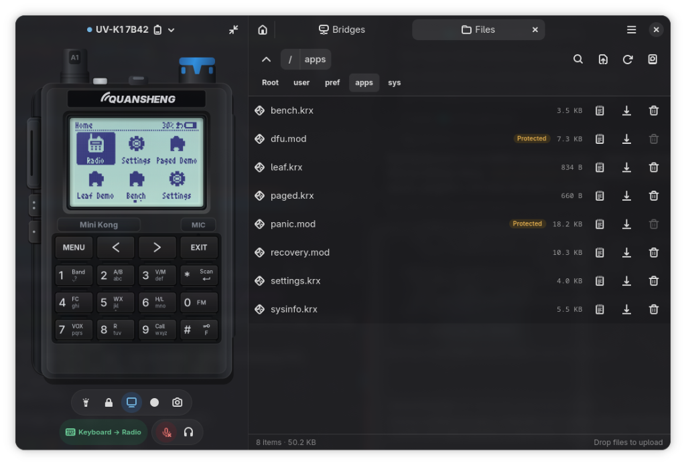

</div>

---

## Overview

Kern is an open-source firmware, package ecosystem, and host tool suite maintained by [OpenTaiko (`qshosfw`)](https://github.com/qshosfw) for Cortex-M0+ handheld transceivers built around the PY32F071xB (128 KB internal Flash, 16 KB SRAM, 2 MB external SPI Flash), including the **Quansheng UV-K1**, **UV-K5 v3 / UV-K6**, and **K10 Pro**.

Instead of compiling every radio screen, utility, font, and translation into a single monolithic ROM image, Kern splits the system cleanly:

- A **resident microkernel** (`src/`) stays small inside the 128 KB MCU Flash, handling hardware drivers, RF arbitration, display compositing, power management, copy-on-write storage, Ascon cryptography, and USB-C / UART communications.
- **External userland packages** (`packages/`) — including the VFO transceiver, Settings, DFU updater, Recovery shell, Multiboot, Crash Inspector, Calibration viewer, and System Info — live on the external 2 MB SPI Flash as relocatable `.krx` / `.mod` binaries executed through a single-entry syscall ABI (`kern_call`).
- **Media packs** (`assets/`) store compiled pixel fonts, 16×16 icons, and 13 interface localizations outside MCU ROM.
- **Kern Dock** (`dock/`) and the **cross-platform CLI** (`./kern`, `kern.cmd`) provide live display mirroring, keyboard and rotary-encoder control, native OS filesystem mounting, flashing, backups, hex inspection, and package provisioning on Linux, macOS, and Windows.

### Key Properties

- **Zero dynamic heap allocation** — `#![no_std]` across the entire Rust workspace. No `alloc`, `Box`, or heap `Vec`; every buffer is statically allocated, arena-backed, or bounded with `heapless`.
- **Hardware-decoupled design** — Userland code never touches peripheral registers. Radio operations go through microkernel traits (`RfChannel`, `RfTuning`, `RfModulation`, `RfSquelch`, `RfSubaudible`, `RfFskPhy`, `RfToneGenerator`), graphics target `Canvas`, and storage targets `KernFS`.
- **Divisionless Cortex-M0+ geometry** — All table record formats are exact powers of two ($2^N$ bytes) aligned to 4 KB SPI Flash erase sectors so record lookup compiles to a single shift (`16 + (index << N)`).
- **OS-agnostic open standards** — `RigWire`, `KernFS`, `KRX`, `KFW`, and Kern record tables are self-contained protocols and binary formats supported across Kern Dock and the host tool suite.

---

## Screenshots

### Kern Dock

Kern Dock streams the radio framebuffer over USB-C or UART, renders realistic handset and bare-PCB models, and integrates file browsing, native OS mounting, flashing, backups, hex inspection, audio synthesis, and an embedded terminal.

<div align="center">
  
  <br />
  <sub>R51-V2.1 bare PCB bench model alongside the Firmware Flasher tab.</sub>
</div>

<br />

<table>
  <tr>
    <td align="center" width="33%">
      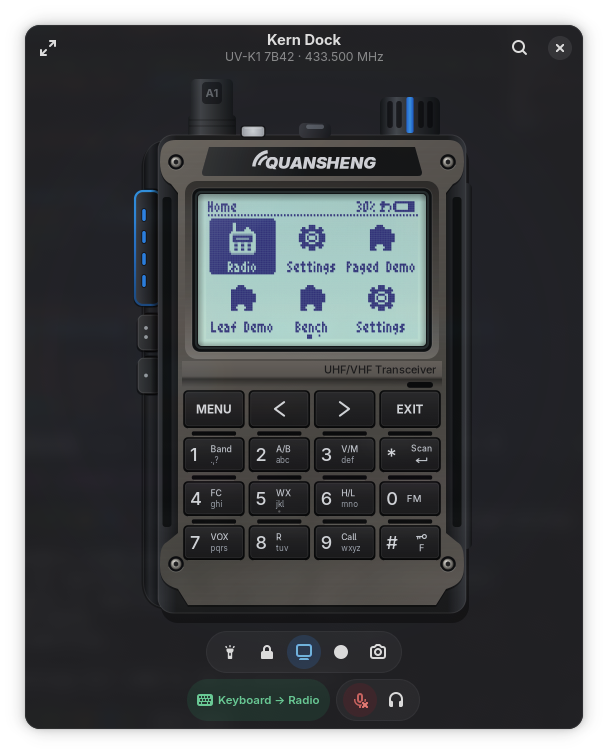<br />
      <sub><b>UV-K1(8) Metallic</b> — Mini-Dock with live launcher and PC keyboard bridge</sub>
    </td>
    <td align="center" width="33%">
      <br />
      <sub><b>UV-K5 Diagonal Grille</b> — Mini-Dock in headless mode</sub>
    </td>
    <td align="center" width="33%">
      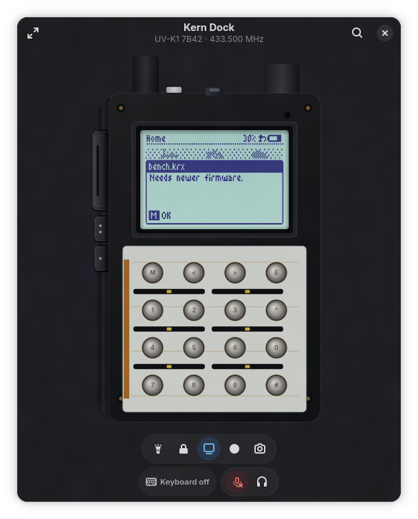<br />
      <sub><b>UV-K1 Open Shell</b> — Exposed snap domes and runtime ABI version guard</sub>
    </td>
  </tr>
</table>

### Radio &amp; Launcher

<table>
  <tr>
    <td align="center" width="25%">
      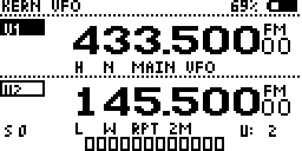<br />
      <sub>Dual-VFO &amp; S-Meter</sub>
    </td>
    <td align="center" width="25%">
      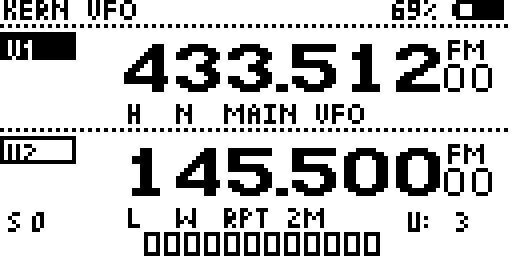<br />
      <sub>Step Tuning</sub>
    </td>
    <td align="center" width="25%">
      <br />
      <sub>App Launcher Grid</sub>
    </td>
    <td align="center" width="25%">
      <br />
      <sub>First-Boot Setup</sub>
    </td>
  </tr>
</table>

### System Modules (`dfu.mod` &amp; `sysinfo.krx`)

<table>
  <tr>
    <td align="center" width="25%">
      <br />
      <sub>DFU Standby</sub>
    </td>
    <td align="center" width="25%">
      <br />
      <sub>DFU USB Ready</sub>
    </td>
    <td align="center" width="25%">
      <br />
      <sub>DFU Flashing</sub>
    </td>
    <td align="center" width="25%">
      <br />
      <sub>DFU Complete</sub>
    </td>
  </tr>
  <tr>
    <td align="center" width="25%">
      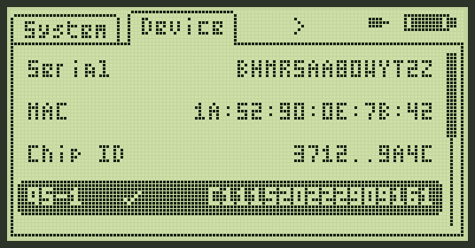<br />
      <sub>Device &amp; OTP Identity</sub>
    </td>
    <td align="center" width="25%">
      <br />
      <sub>MCU &amp; Clocks</sub>
    </td>
    <td align="center" width="25%">
      <br />
      <sub>Battery &amp; Storage</sub>
    </td>
    <td align="center" width="25%">
      <br />
      <sub>Regulatory Marks</sub>
    </td>
  </tr>
</table>

### Localization &amp; Text Input

<div align="center">
  
</div>

<br />

<table>
  <tr>
    <td align="center" width="25%">
      <br />
      <sub>Language Picker</sub>
    </td>
    <td align="center" width="25%">
      <br />
      <sub>Russian Launcher</sub>
    </td>
    <td align="center" width="25%">
      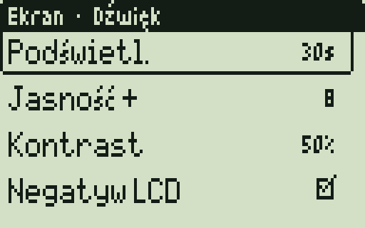<br />
      <sub>Polish Settings</sub>
    </td>
    <td align="center" width="25%">
      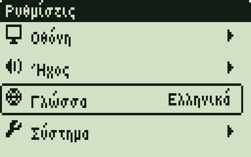<br />
      <sub>Greek Settings</sub>
    </td>
  </tr>
  <tr>
    <td align="center" width="25%">
      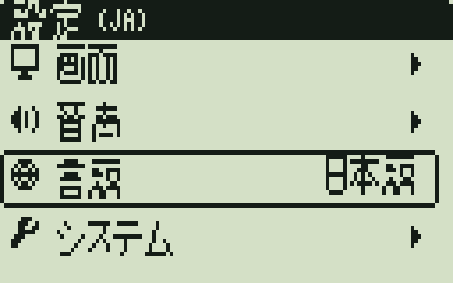<br />
      <sub>Japanese (日本語)</sub>
    </td>
    <td align="center" width="25%">
      <br />
      <sub>Chinese (中文)</sub>
    </td>
    <td align="center" width="25%">
      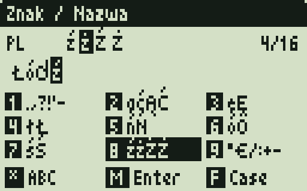<br />
      <sub>Latin Diacritics Input</sub>
    </td>
    <td align="center" width="25%">
      <br />
      <sub>Cyrillic Input</sub>
    </td>
  </tr>
</table>

<details>
<summary>Additional captures (Italian, Ukrainian, Dutch, Portuguese, Russian Settings, Greek Input, System Modules &amp; SAR)</summary>

<br />

<table>
  <tr>
    <td align="center" width="25%">
      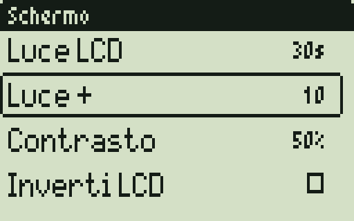<br />
      <sub>Italian (Italiano)</sub>
    </td>
    <td align="center" width="25%">
      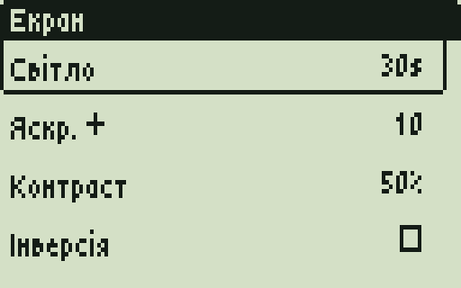<br />
      <sub>Ukrainian (Українська)</sub>
    </td>
    <td align="center" width="25%">
      <br />
      <sub>Dutch (Nederlands)</sub>
    </td>
    <td align="center" width="25%">
      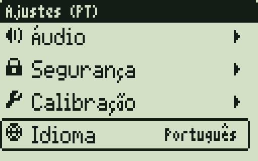<br />
      <sub>Portuguese (Português)</sub>
    </td>
  </tr>
  <tr>
    <td align="center" width="25%">
      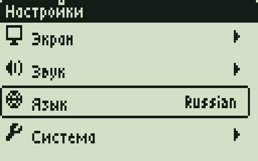<br />
      <sub>Russian Settings</sub>
    </td>
    <td align="center" width="25%">
      <br />
      <sub>Greek Text Input</sub>
    </td>
    <td align="center" width="25%">
      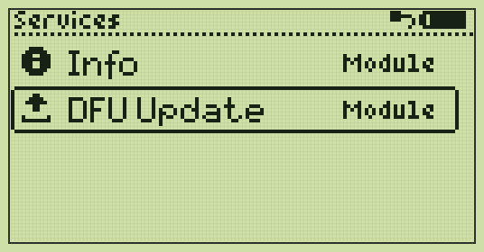<br />
      <sub>System Modules Menu</sub>
    </td>
    <td align="center" width="25%">
      <br />
      <sub>SAR &amp; Compliance</sub>
    </td>
  </tr>
</table>

</details>

---

## Supported Hardware

| Device | MCU | Internal Flash / SRAM | External SPI Flash | RF &amp; Peripherals | Status |
|---|---|---|---|---|---|
| **Quansheng UV-K1 / UV-K1(8)** | PY32F071xB (Cortex-M0+ @ 48 / 72 MHz) | 128 KB / 16 KB | PY25Q16 (2 MB) | BK4829, BK1080, ST7565, Native USB-C | Primary |
| **Quansheng UV-K5 v3 / UV-K6** | PY32F071xB (Cortex-M0+ @ 48 / 72 MHz) | 128 KB / 16 KB | PY25Q16 (2 MB) | BK4829, BK1080, ST7565, UART / USB | Supported |
| **Quansheng K10 Pro** | PY32F071xB (Cortex-M0+ @ 48 / 72 MHz) | 128 KB / 16 KB | PY25Q16 (2 MB) | Dual knobs, GNSS / extended IO | Experimental (`target_k10pro`) |
| **QEMU `uv-k5-v3`** | Emulated ARMv6-M | 128 KB / 16 KB | Virtual 2 MB | Virtual LCD, keypad, RigWire TCP | Supported |

### On-Board Hardware Subsystems

- **MCU**: Puya `PY32F071xB` ARM Cortex-M0+ running at 48 MHz (HSI 16 MHz × PLL 3× with USB CTC SOF clock trimming) or optional dynamic 72 MHz overclock, with independent watchdog (`IWDG`), `LPTIM1` STOP-mode wake timer, backup domain registers, and factory hardware UID.
- **RF Transceiver (`BK4829`)**: Wideband VHF/UHF transceiver with dynamic modulation profiles (FM, AM, USB/LSB, FSK, CW), programmable squelch/RSSI/glitch/noise detection, CTCSS/CDCSS subaudible signaling, hardware FSK modem, continuous-phase AFSK, and dual 26 MHz DDS tone generators (`Reg 0x70–0x72`).
- **Broadcast Receiver (`BK1080`)**: Feature-gated 64–108 MHz FM broadcast receiver (`fm_radio`).
- **Audio Path**: External `LN4898` audio power amplifier gated via `PA8` (`<0.1 µA` shutdown) with a 2-second post-tone hangover timer to prevent key-repeat pops, paired with an 11-step BK4829 digital AF preamp/DAC gain curve (`Reg 0x48`) feeding the physical analog volume potentiometer.
- **Display (`ST7565`)**: 128×64 monochrome LCD over SPI with contrast control, PWM backlight controller, sleep/hold-dark latching, 1-bit spatial dithering, and optional 2-bit 4-level temporal FRC grayscale (`grayscale`).
- **Storage (`PY25Q16`)**: 2 MB SPI NOR Flash (4 KB erase sectors, 256 B pages) hosting `KernFS` with deep power-down support during STOP sleep.
- **Input**: 19-key parallel matrix scanner (3-sample contact debounce, hold/repeat timing, CW key duration tracking) plus dedicated `PTT` pin (`PB10`) and `Event::Encoder(i8)` rotary input.
- **Connectivity**: Native USB 2.0 Full-Speed (`36b7:ffff`) presenting CDC ACM virtual serial for RigWire, plus 2-pin Kenwood UART (`USART1`).

---

## Getting Started

### Prerequisites

- **Rust nightly** — automatically selected by [`rust-toolchain.toml`](rust-toolchain.toml) (`thumbv6m-none-eabi` + `rust-src`)
- **ARM GCC** (`arm-none-eabi-gcc`, `arm-none-eabi-objcopy`) — required to compile and link `.krx` / `.mod` packages
- **Python 3.11+** — core CLI uses only the Python standard library; `pyserial` enables hardware serial/USB operations; `PyGObject` (GTK4 + Libadwaita + VTE) enables Kern Dock

Run the cross-platform environment check first (`./kern` on Linux/macOS, `kern.cmd` on Windows):

```bash
git clone https://github.com/qshosfw/kern.git
cd kern
./kern doctor
```

### Build, Verify, and Flash

```bash
# Verify C SDK opcodes match src/abi
./kern abi --check

# Type-check with zero warnings and run all native host unit tests
./kern check --deny-warnings
./kern test

# Build release firmware (.bin, packed bootloader binary, .kfw, QEMU .elf)
./kern build
./kern size

# Build all 14 external userland packages (.krx / .mod)
./kern pkg all

# Check connected USB-C / serial radios and flash via serial bootloader (hold PTT on power-on)
./kern ports
./kern flash
```

### Provision Packages and Launch Kern Dock

```bash
# Provision core apps (vfo.krx + settings.krx) over RigWire
./kern provision --port /dev/ttyACM0 --bundle core

# Provision core apps + system modules (calib, dfu, recovery, panic, sysinfo)
./kern provision --port /dev/ttyACM0 --bundle sys

# Mount the radio's KernFS as a native OS drive
./kern mount --port /dev/ttyACM0 --auto-mount --open

# Launch Kern Dock
./kern dock
```

### Running Without Hardware (Demo &amp; QEMU)

```bash
# Launch Kern Dock with the built-in interactive demo radio
./kern dock --demo

# Launch the QEMU ARMv6-M hardware emulator and attach Kern Dock over TCP
./kern emu
./kern dock -p tcp://127.0.0.1:4446
```

### On-Device Shortcuts &amp; Recovery Controls

| Gesture / Key Combo | Context | Action |
|---|---|---|
| Hold `PTT` on power-on | Boot | Enter stock serial bootloader (`38400` baud) for flashing |
| Hold `MENU + EXIT` (3 s) | Headless Mode | Exit headless mode, wake LCD &amp; backlight, restore local keypad |
| Hold `F` / `#` | Anywhere | Lock or unlock the keypad |
| Hold `EXIT` | Launcher | Enter Deep Sleep (STOP mode); inhibited while USB, RigWire, or headless is active |
| Hold `EXIT` | Inside an App | Force-close active application and return to Launcher |

---

## Kern Dock

[Kern Dock](dock/README.md) (`./kern dock`) is a standalone PEP 621 package (`dock/src/kern_dock/`) providing a native **GTK4 + Libadwaita 1.8** companion for any radio speaking **RigWire** and open Kern formats (`KernFS`, `KRX`, `KFW`, Kern record tables). It is OS-agnostic: the protocol state is `link_mode = "rigwire" | "stock_bl"` and the displayed firmware identity is resolved dynamically from RigWire `HELLO` / telemetry.

### Workspace Tabs &amp; Views (`dock/src/kern_dock/ui/views/`)

| Tab | Module | Functionality |
|---|---|---|
| **Home** | `overview.py` | Connection screen (USB auto-detect, Demo, QEMU), device hero card, battery/link/VFO/uptime tiles, quick tool launcher, collapsible Device Identity (serial, MAC, calibration status, clock), USB TX safety toggle, storage policy switches, reboot controls (Restart / Recovery / Bootloader) |
| **Radio** | `radio.py` | Live VFO A/B frequency card with linked `−`/`+` step buttons and scroll-wheel tuning, discrete S-meter (dBm), direct MHz entry, modulation picker, squelch spinner, VFO swap, PC keyboard and live-typing switches |
| **Files** | `files.py` | Lazy-loaded KernFS browser with breadcrumb pathbar, quick places (`/`, `/user`, `/pref`, `/apps`, `/sys`), collapsible filter (`Ctrl+F`), refresh (`F5`), parent navigation (`Alt+Up`), drag-and-drop upload, hex viewer, and non-blocking native OS WebDAV mount with inline status strip (`Open`, `Copy`, `Unmount`) |
| **Flasher** | `firmware.py` | Bootloader state monitor, one-click bootloader entry, `.kfw`/`.bin` pre-flight verifier, hex preview, stock bootloader page flasher with live torch pulse, and automatic post-flash reconnect |
| **Apps** | `apps.py` | Lazy two-phase app manager rendering authentic 1-bit pixel-art icons (from KRX `SECTION_ASSETS` or Kern icon pack), bounded header-only reads (`read_head` ≤ 512 B, zero full-file CRC scans), cached metadata, drag-and-drop install, hex inspection, and uninstall with recovery-module shields |
| **Backups** | `backups.py` | Multi-format backup creator (`.kfw` Ascon-Hash256 snapshot, portable `.zip` with `manifest.json`, calibration `.kfw`, raw 512 B `.dat`), interactive archive inspector, per-entry extraction, hex inspection, and `/sys`-shielded restore |
| **Terminal** | `terminal.py` | Lazy-spawned embedded GTK4 `Vte-3.91` shell (16-color palette, `Ctrl+Shift+C`/`V`, zoom, preloaded `KERN_PORT` / `KERN_VOLUME` / `KERN_MOUNT_PATH`), pop-out OS terminal, plus interactive RigWire command console with command history |
| **Capture** | `capture.py` | Instant PNG snapshots (LCD-only or full handset body) and non-destructive GIF timeline recorder with trim, cut, splice, and playback preview |

### Handset Models, Audio, Input, Bridges &amp; Automation

- **12 Handset &amp; Bench Models (`render/handset/`)**: `k1` (`UV-K1(8)` metallic), `k1-polymer` (`UV-K1 Matte Black`), `k1-clear` (`UV-K1(8) Transparent`), `k5v3` (`UV-K5 v3 / UV-K6`), `k5-orange` (`UV-K5(8) Safety Orange`), `k5-black` (`UV-K5 Diagonal Grille`), `k5-99` (`UV-K5(99) Charcoal`), `k5-99-red` (`UV-K5(99) Red`), `uv5r-plus` (`UV-5R Plus`), `k10-pro` (`UV-K10 Pro`), `k1-naked` (`UV-K1 Open Shell`), and `pcb-r51` (`R51-V2.1 Bare PCB`). Includes forgiving nearest-button hit-testing (`hit_test_handset`), authentic ST7565 LCD optics (`render/lcd.py`), and floating Mini-Dock mode (`Ctrl+M`).
- **Input Bridge (`ui/widgets/keyboard_bridge.py`)**: Maps PC keys to handset buttons (`Ctrl+K`), streams direct UTF-8 characters (`FACET_INPUT_TEXT`), provides a T9 multi-tap planner (`device/t9.py`), and converts both discrete mouse wheel notches and Wayland two-finger touchpad scrolling into `Event::Encoder(i8)` detents.
- **Headless Audio &amp; Kenwood Audio (`audio/`)**: `synth.py` drains RigWire headless audio rings every 25 ms and synthesizes exact 26 MHz BK4829 DDS sine frequencies (`bk4829_quantize_hz`) with 1.5 ms anti-click ramps and 1 ms inter-note gaps; `kenwood.py` routes Kenwood 2-pin sound-card RX/TX audio.
- **Colored Hex Inspector (`ui/widgets/hex_view.py`)**: Byte-class color highlighting (headers, zeros, `0xFF`, printable ASCII, control bytes), Kern table record-stride shading, live cursor data decoder (`Offset`, `Bin`, `u8/i8`, `u16`, `u32`, `f32`, `Char`), jump-to-offset, search, copy, and raw export.
- **Ham Radio Bridges (`bridges/`)**: Built-in **KISS TNC** TCP server (`127.0.0.1:8001`, `kiss.py`) for APRS/packet apps and **Hamlib `rigctld`** TCP server (`127.0.0.1:4532`, `rigctld.py`) for SDR/logging software.
- **Security &amp; OS Integration (`core/security.py`, `system/`)**: Hardened Mode (blocks writes, flashing, bootloader entry, and TX), timed TX arming/interlock with audit log, pure GLib/Gio D-Bus System Tray (`StatusNotifierItem` + `dbusmenu`), `0600` local Unix socket JSON-RPC &amp; Session D-Bus IPC (`./kern dock ctl`), desktop `.desktop` + SVG icon installer, and a capability-scoped plugin system (`plugins/builtin/`: `band-presets`, `radio-bridges`, `table-inspector`, `telemetry-monitor`, plus user drop-ins in `~/.config/kern-dock/plugins/`).

```bash
./kern dock                     # Launch full GTK4 companion
./kern dock --mini              # Floating Mini-Dock mode
./kern dock --headless          # Enable radio headless mode on connect
./kern dock --hardened          # Start in Hardened Mode (read-only, TX disarmed)
./kern dock ctl status          # Query running Dock instance over local IPC
./kern dock ctl freq 145.500    # Tune running radio from shell / scripts
./kern dock models [--json]     # List all 12 handset & bench models
./kern dock plugins [--json]    # List discovered plugins & capabilities
./kern dock install-desktop     # Install .desktop launcher & SVG icons
./kern dock build               # Bytecode compile check + automated unit tests
```

---

## Packages

External packages live under [`packages/`](packages/README.md) and are built from `krx.toml` manifests via `./kern pkg` (`tools/pkg.py` + `tools/pack_krx.py`). List all packages with `./kern pkg --list`.

### Core Applications (`packages/core/`)

| Package | Output | Profile | Description |
|---|---|---|---|
| [`core/vfo`](packages/core/vfo/krx.toml) | `vfo.krx` | `N1` PIC (Rust) | Dual-VFO radio transceiver HUD, Dual Watch, Cross-Band, S-meter, rotary tuning |
| [`core/settings`](packages/core/settings/krx.toml) | `settings.krx` | `P0` Paged (Rust, 17 leaves) | Full System Settings: Device identity (`Model`, `Owner`, `Tag`, `Radio ID`, `Language`, `Bandplans`, `Boot Splash`), Audio (`Roger Beep`, `Boot Jingle`), Buttons (`Shortcuts`), System Modules launcher, and 16×16 App Manager |

### System &amp; Maintenance Modules (`packages/sys/`)

| Package | Output | Profile | Description |
|---|---|---|---|
| [`sys/calib`](packages/sys/calib/krx.toml) | `calib.mod` | `N1` PIC (Rust) | Factory RF and battery calibration inspector (`/sys/calib.dat`) |
| [`sys/dfu`](packages/sys/dfu/README.md) | `dfu.mod` | `P0` Paged | Visual USB-C / UART DFU updater with hardware quiescing and SRAM flash hook |
| [`sys/recovery`](packages/sys/recovery/README.md) | `recovery.mod` | `P0` Paged | On-device recovery shell and SRAM flasher |
| [`sys/multiboot`](packages/sys/multiboot/README.md) | `multiboot.mod` | `P0` Paged | Multi-slot firmware bootloader manager |
| [`sys/panic`](packages/sys/panic/krx.toml) | `panic.mod` | `P0` Paged | Crash inspector, stack/register dump, Thumb-1 disassembler, and QR report generator |
| [`sys/sysinfo`](packages/sys/sysinfo/README.md) | `sysinfo.krx` | `P0` Paged | Hardware identity, OTP certificate, power/thermal/storage telemetry, and regulatory info |

### Optional Apps &amp; Templates (`packages/apps/`, `packages/examples/`)

| Package | Output | Profile | Description |
|---|---|---|---|
| `apps/beacon` | `beacon.krx` | `N1` PIC | Radio and display beacon utility |
| `apps/bench` | `bench.krx` | `N1` PIC | C-ABI and capability validation benchmark suite |
| `examples/hello_rust` | `hello_rust.krx` | `N1` PIC (Rust) | Minimal `#![no_std]` Rust `kern-sdk` starter app |
| `examples/hello_c` | `hello_c.krx` | `N1` PIC (C) | Minimal C `sdk/c/krx.h` starter app |

### KRX Binary Format &amp; Execution Profiles

Every `.krx` / `.mod` binary starts with the 4-byte format identifier `C0 DE 01 FE`, a fixed 24-byte preamble, and 4-byte-aligned TLV sections:

- `0x0001` (`SECTION_IDENTITY`) — Display name, semantic version, author callsign, and default icon ID.
- `0x0004` (`SECTION_ASSETS`) — Embedded 1-bit pixel bitmaps (16×16 launcher icon, 8×8 list icon, 5×5 tray badge) read directly by both the radio Launcher and Kern Dock.
- `0x0009` (`SECTION_LIFECYCLE`) — Executable kind (`App`, `Service`, `Daemon`, `Driver`, `Module`), lifecycle flags (`startup`, `persistent`, `restart_on_fail`, `singleton`), and required hardware capability mask (`Cap`).
- **Execution profiles**:
  - **`N0` / `N1` (Native PIC)** — Position-independent Thumb-1 code loaded directly into the 8 KB SRAM execution arena.
  - **`P0` (Structured Paged)** — Root stub plus up to 1 KB on-demand leaves swapped from SPI Flash (used by `settings.krx`, `dfu.mod`, `sysinfo.krx`).
  - **`P1` (Demand-Paged)** — Transparent page-faulting window cache (~1.1 KB Flash overhead) for larger binaries.

---

## Localization

Kern supports **13 languages** (built-in English plus 12 TOML string catalogs in [`assets/lang/`](assets/lang/)) compiled with pixel fonts and icon catalogs by `./kern media` (`tools/pack_media.py`):

| Script | Languages |
|---|---|
| Latin | English (`en`), German (`de`), Spanish (`es`), French (`fr`), Italian (`it`), Dutch (`nl`), Polish (`pl`), Portuguese (`pt`) |
| Cyrillic | Russian (`ru`), Ukrainian (`uk`) |
| Greek | Greek (`el`) |
| CJK | Japanese (`ja`), Chinese (`zh`) |

`./kern media` compiles:
- **`.fnt`** — Compact pixel font packs (`build-tiny5` for extended Latin/Cyrillic/Greek; `pack-bdf` for BDF 2.1 fonts including Fusion Pixel CJK, Ark Pixel, and Misaki).
- **`.icn`** — 1-bit pixel icon packs from ASCII catalogs (`assets/icons/kern_apps_16.txt`).
- **`.lng`** — Binary localization packs validated against target `.fnt` glyph coverage (`check-lang`) with CRC verification (`inspect`).

---

## CLI &amp; Host Tool Suite

The unified cross-platform CLI (`./kern` on Linux/macOS, `kern.cmd` on Windows) delegates to [`tools/kern_cli.py`](tools/kern_cli.py) and shares [`tools/cli_ui.py`](tools/cli_ui.py) across tools — enforcing `NO_COLOR`, `--no-color`, `--json`, TTY detection, Windows VT100/UTF-8 console setup, `stderr` diagnostics, `os.pathsep` paths, command typo suggestions, and POSIX exit codes (`0`, `1`, `2`, `130`).

### `./kern` Command Reference

| Command | Aliases | Description |
|---|---|---|
| `./kern build` | *(default)* | Build release firmware, emit packed bootloader binary, verify Flash/SRAM budgets |
| `./kern check` | | Fast syntax and type check (`--deny-warnings`) |
| `./kern size` | | Detailed Flash and SRAM section breakdown |
| `./kern info` | `dry-run` | Show target MCU, active feature gates, and resolved memory budgets |
| `./kern flash` | | Build and flash firmware over serial bootloader |
| `./kern clean` / `distclean` | | Clean Cargo target (`distclean` also cleans package &amp; Dock build caches) |
| `./kern test` | | Run native host unit tests across all workspace crates |
| `./kern fmt` | `format` | Format all Rust code with `rustfmt` |
| `./kern lint` | | Run heuristic architectural linter (`tools/archlint.py`) |
| `./kern bloat` | | Run ELF symbol, stack, rodata, and monomorphization analyzer (`tools/bloat.py`) |
| `./kern disasm` | | Disassemble compiled Cortex-M0+ release binary |
| `./kern dock` | | Launch Kern Dock desktop companion |
| `./kern wire` | `monitor` | RigWire serial host tool and file transfer CLI |
| `./kern provision` | | Provision `.krx` / `.mod` package bundles over RigWire |
| `./kern mount` | | Mount radio KernFS natively on Linux, macOS, and Windows via WebDAV |
| `./kern ports` | `devices` | List active USB and serial radio ports (`--all`, `--json`) |
| `./kern emu` | | Launch QEMU hardware emulator and Web UI |
| `./kern pkg` | `packages` | Build or list KRX packages (`--list`, `--json`) |
| `./kern abi` | | Regenerate or verify `sdk/c/krx_ops.h` from `src/abi` (`--check`) |
| `./kern kfw` | | Pack, inspect, verify, sign, or extract `.kfw` v1.0 containers |
| `./kern media` | | Compile and inspect `.icn`, `.fnt`, and `.lng` binary packs |
| `./kern doctor` | | Check Rust, ARM GCC, Python, GTK4, and OS mount prerequisites (`--json`) |

### Tool Inventory (`tools/`)

| Tool | Role |
|---|---|
| `cli_ui.py` | Shared zero-dependency cross-platform CLI UI, `NO_COLOR`, tables, progress bars, Windows VT100, and serial port helpers |
| `kern_cli.py` | Unified dispatcher backing `./kern` and `kern.cmd`, including `doctor`, `ports`, and `distclean` |
| `builder.py` | Parses `kern.toml` feature gates and hardware profiles (`UV-K1`, `UV-K5v3`, `UV-K10Pro`), enforces Flash/SRAM ratchets, exports `--json` memory telemetry |
| `flasher.py` | Cross-platform serial bootloader flasher (`38400` baud, VID:PID `36b7:0001` auto-detection) |
| `pack.py` | Stock Quansheng bootloader XOR obfuscator (`target/firmware_packed.bin`) |
| `rigwire.py` | RigWire COBS protocol client library and CLI (telemetry, framebuffer capture, keypad/text/encoder injection, file transfer, KRX sideloading) |
| `kernfs_mount.py` | Hardened localhost WebDAV Class 2 mounter (Linux GIO/GVFS POSIX path resolution, macOS `mount_webdav`, Windows `net use`, DNS-rebinding/CSRF guards, RFC 4331 SPI quota, `fast_stat`, `read_head`, OS junk blackhole, `/sys/*` shields) |
| `kfw.py` | Reference `.kfw` v1.0 packer, verifier, signer (`Ascon-Hash256`, `Ascon-AEAD128`, `Ascon-128-MAC`, `LMS-Ascon`), and extractor |
| `pkg.py` &amp; `pack_krx.py` | Manifest-driven Rust/C package compiler, position-independence guard, and KRX binary packer/verifier |
| `provision.py` | Bundle provisioner (`core`, `sys`, `examples`, `all`) over RigWire |
| `pack_media.py` &amp; `png_to_splash.py` | Binary `.fnt` / `.icn` / `.lng` pack compiler and 128×64 monochrome splash converter |
| `bloat.py` &amp; `archlint.py` | Release ELF bloat analyzer (stack frames, imm5 struct penalties, duplicate Thumb routines, rodata, literal pools, baseline diffs) and static Rust architectural smell scanner |
| `emulator_helper.py` | External QEMU `uv-k5-v3` launcher (`KERN_EMU_DIR`, `KERN_QEMU_BIN`) |
| `test_kern_emulator.py` &amp; `test_wire_emu.py` | Automated headless QEMU integration suites for boot, UI, and RigWire |

<details>
<summary>Declarative feature gates in <code>kern.toml</code> (disabled features cost 0 bytes of Flash)</summary>

- **hardware**: `radio` (BK4829), `fm_radio` (BK1080), `uart`, `usb`, `usb_cdc`, `wire` (RigWire), `usb_msc`, `usb_msc_fat`
- **storage_security**: `filesystem` (KernFS), `secure_fs` (Ascon-128), `passcode` (boot PIN KDF), `app_hibernation`
- **runtime**: `krx_native` (N0/N1/P0), `krx_paged` (P1 demand-paged window cache)
- **provisioning**: `provision_apps`, `provision_rogers`, `extra_rogers`, `boot_assets`, `boot_jingle`
- **display**: `animations` (60–90 Hz kinetic transitions), `grayscale` (2-bit 4-level temporal FRC)
- **diagnostics**: `overclock_72mhz`, `settings_info`, `settings_calib`, `settings_debug`
- **bootloader**: `dfu` (compiled-in fallback when `/apps/dfu.mod` is not provisioned)

</details>

---

## Standards &amp; Protocols

### RigWire (`src/kernel/src/wire/`, `src/firmware/src/services/wire.rs`)

COBS-framed binary protocol running over USB-C CDC (`36b7:ffff`) or UART using `(domain, instance, facet)` resource handles and four standard control operations (`OP_HANDLE_GET`, `OP_HANDLE_SET`, `OP_HANDLE_INVOKE`, `OP_HANDLE_STREAM`) plus a dedicated Data service (`SERVICE_DATA`) for chunked transfers:

| Domain | ID | Key Facets &amp; Operations |
|---|---|---|
| `SYSTEM` | `0x00` | Identity, live metrics (uptime, sysclk, battery mV/%, active app, lock, torch, LED, BK4829 GPIO, headless flag), calibration, headless audio tone ring (`FACET_SYS_AUDIO`), reboot, flashlight, headless toggle |
| `RADIO` | `0x01` | Tuning (Hz, step), modulation/bandwidth, squelch/RSSI/carrier, transmit (PTT/power with link-loss failsafe), digital sub-Hz vernier &amp; CP-AFSK, VFO toggle |
| `UI` | `0x02` | Strip-delta 128×64 framebuffer stream (`FACET_UI_SURFACE`), active modal inspection/dismissal (`FACET_UI_MODAL`), active view navigation (`FACET_UI_VIEW`) |
| `INPUT` | `0x03` | Keypad events (`FACET_INPUT_KEY`), keypad lock (`FACET_INPUT_LOCK`), UTF-8 text injection (`FACET_INPUT_TEXT`), rotary encoder detents (`FACET_INPUT_ENCODER`) |
| `CONFIG` | `0x04` | Version-checked, locally re-clamped &amp; CRC-sealed whole-block config reads/writes across `display`, `audio`, `keys`, `system`, `battery`, and `apps` |
| `APP` | `0x05` | Registry enumeration and lifecycle launch/kill |
| `DATA` | `0x03` (svc) | `TRANSFER_OPEN` / `CHUNK` / `CLOSE` / `ABORT` / `STAT` / `LIST` / `REMOVE`, supporting bounded header-only reads (`read_head`) and CRC-32 write verification |

### KernFS &amp; Power-of-Two Record Geometry (`src/fs/`)

Flat, copy-on-write 256-byte page filesystem directly on SPI Flash with automatic garbage collection, zero archive containers, and 4 KB erase-sector alignment. Record offsets compute without division (`offset = 16 + (index << N)`):

| Path | Header ID | Record Size | Contents |
|---|---|---|---|
| `/user/channels.ch` | `CHAN` (16 B) | `64 B` ($2^6$) | Memory channels + 16 B opaque `user_tag` (`[u8; 4]` tag + `[u8; 12]` payload) |
| `/user/contacts.ct` | `CONT` (16 B) | `32 B` ($2^5$) | Callsigns and directory contacts |
| `/user/bandplans.bnd` | `BNDP` (16 B) | `32 B` ($2^5$) | Regional band plans and TX/RX frequency limits |
| `/user/zones.zn` | `ZONE` (16 B) | `32 B` ($2^5$) | Channel zone groupings |
| `/user/scanner.hit` | `HITS` (16 B) | `32 B` ($2^5$) | Logged frequency scanner hits |
| `/user/fm_radio.fm` | `FMBC` (16 B) | `16 B` ($2^4$) | Broadcast FM station presets |
| `/user/vfo_a.vfo`, `vfo_b.vfo` | Composite | `160 B` | Two-tier VFO state (32 B header + 2× 64 B records; volatile SRAM updates, idle/power-down persistence) |
| `/pref/*.cfg` | Domain CRC32 | Modular | `display.cfg`, `audio.cfg`, `keys.cfg`, `battery.cfg`, `system.cfg` |
| `/sys/calib.dat`, `calib.sig` | Raw + MAC | `512 B` + `32 B` | Factory calibration authenticated via hardware-UID-bound Ascon-128 MAC |
| `/apps/*.krx`, `*.mod` | `C0 DE 01 FE` | Relocatable | Installed userland applications and system modules |

### `.kfw` v1.0 Container (`tools/kfw.py`)

Binary container for firmware images, multi-target bundles, and verified KernFS snapshots:
- 3 core structures: `KfwHeader` (64 B), `KfwPart` (32 B), `KfwTlv` (4 B).
- 100% Ascon cryptography (`Ascon-Hash256`, `Ascon-AEAD128`, `Ascon-128-MAC`, post-quantum `LMS-Ascon`), bit-exact with `src/crypto/src/ascon.rs`.
- Solid `ARMTHUMB+LZMA2` compression plus MCU-streamable `None` and `PackBits RLE` codecs.
- Pre-flash validation: target matching, bootloader &amp; QS-1 calibration page address fences, ARMv6-M vector checks, KRX-ABI bounds, KernFS path-traversal guards, and monotonic `sec_cnt` anti-rollback.

### Headless Node Mode (`src/firmware/src/system/headless.rs`)

Built for unattended remote sites, mast/junction-box nodes, digital packet/APRS stations, and desktop RigWire setups:
- Puts the ST7565 panel to sleep, latches backlight dark (`hold_dark`), forces the flashlight off, and disables the local LN4898 speaker PA while routing tones to the 16-slot RigWire audio ring.
- Inhibits Deep Sleep / APO and suppresses local sleep hold prompts and low-battery modal dialogs.
- Enforces a **5-second TX link-loss failsafe** (`enforce_tx_failsafe`) if a wire-keyed transmission loses its controlling host.
- Survives warm resets via `BackupCrashTag::FLAG_HEADLESS` and total power loss via `/pref/keys.cfg`.
- **Physical escape chord**: Hold **`MENU + EXIT` for 3 seconds** on the physical radio to exit headless mode, wake the LCD &amp; backlight, persist the state, and ignore residual key events until both keys are released.

---

## Architecture &amp; Workspace Components

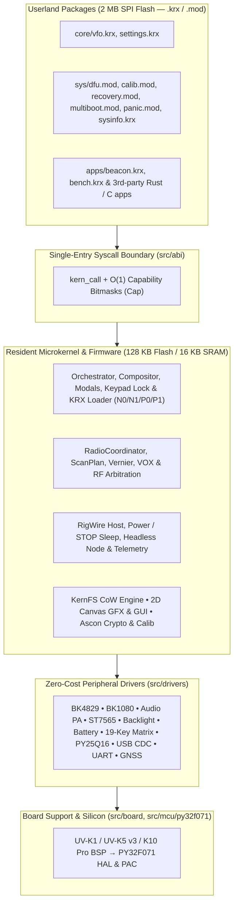

### Memory Budget &amp; Silicon Constraints

| Region | Budget | Allocation |
|---|---|---|
| **MCU Internal Flash** | 128 KB (`118 KB` budget / ratcheted ceiling in `kern.toml`) | Resident microkernel, drivers, KernFS, GFX, Ascon crypto, RigWire host, KRX loader |
| **MCU Internal SRAM** | 16 KB | Static kernel state, 8 KB relocatable KRX execution arena, staging buffer, call &amp; IRQ stacks |
| **External SPI Flash (`PY25Q16`)** | 2 MB (512 × 4 KB sectors) | KernFS: `/apps/*.krx`, `/apps/*.mod`, `/user/*`, `/pref/*.cfg`, `/sys/*`, fonts, icons &amp; locales |

### Workspace Crate Breakdown (`Cargo.toml`)

| Crate | Path | Responsibility |
|---|---|---|
| **`abi`** | [`src/abi/`](src/abi/) | Single source of truth for syscall opcodes (`ops.rs`), capabilities (`cap.rs`), system properties (`prop.rs`), package headers (`pkg.rs`), C-ABI types (`types.rs`), and the `abigen` host generator that emits `sdk/c/krx_ops.h` |
| **`kernel`** | [`src/kernel/`](src/kernel/) | Pure `#![no_std]` microkernel contracts: `app`, `boot`, `caps`, `dev`, `event` (`Key`, `Char`, `Encoder`, `Bus`, `Usb`, `Tick`), `ipc`, `mem`, `nav`, `power`, `proc`, `runtime`, `sched`, `security`, `service` (radio coordinator, tone gen, vernier, VOX, power, storage), `store`, `tag`, `ui`, and `wire` |
| **`kernfs`** | [`src/fs/`](src/fs/) | Power-loss-safe copy-on-write 256-byte page SPI Flash filesystem (`device`, `format`, `fs`, `gc`) with host test suite |
| **`drivers`** | [`src/drivers/`](src/drivers/) | Peripheral drivers implementing `Driver` (`descriptor`, `bus`, `init`): `bk4829` (`af`, `agc`, `fsk`, `registers`, `squelch`, `subaudible`, `tuning`), `bk1080`, `audio` (LN4898 PA + hangover), `backlight`, `battery` (voltage curves &amp; power sensing), `keyboard` (19-key debounced matrix), `st7565`, `py25q16`, `filesystem`, `usb` (`cdc`, `descriptors`, `msc`, `fat`), `uart`, `wire`, `gnss`, and `registry` |
| **`gfx`** | [`src/gfx/`](src/gfx/) | 2D `Canvas` abstraction (monochrome &amp; 2-bit grayscale), primitives (`draw`, `bmp`), typography (`text`, `fonts`), 1-bit `icons`, binary `media` pack reader, `widgets`, and `gui` components (menus, option sheets, text input) |
| **`crypto`** | [`src/crypto/`](src/crypto/) | `ascon` (Ascon-128 AEAD/MAC/Hash256), `crc` (CRC-16/CRC-32), `cobs` framing, `trng`, and fixed buffers |
| **`calib`** | [`src/calib/`](src/calib/) | 512-byte factory calibration parsing, TX power bias tables, squelch thresholds, crystal trim, and battery curves |
| **`util`** | [`src/util/`](src/util/) | Divisionless Cortex-M0+ integer `math`, `dsp`, fixed-point `units` (`Frequency`), `bytes`, `format`, `gsm7`, `mbuf`, `path`, and packed `serde` helpers |
| **`hal-traits`** | [`src/hal-traits/`](src/hal-traits/) | Hardware-agnostic trait boundaries decoupling drivers from MCU silicon |
| **`py32f071-pac` / `hal`** | [`src/mcu/py32f071/`](src/mcu/py32f071/) | Register PAC and bare-metal HAL for `PY32F071xB`: `rcc`, `gpio`, `spi`, `i2c`, `uart`, `usbd`, `adc`, `dma`, `tim`, `lptim`, `exti`, `pwr`, `rtc`, `flash`, `crc`, `comp`, `wdt`, `uid`, `delay` |
| **`bsp`** | [`src/board/uv-k1/`](src/board/uv-k1/) | Board support package (`board`, `hw`, `pins/k1_family`, `pins/k10_pro`, `entropy`, `uid`) with static dispatch |
| **`firmware`** | [`src/firmware/`](src/firmware/) | Resident OS image: `boot` (crash-loop strike recovery, backup domain, security), `config` (modular `/pref/*.cfg`), `data` (static arena &amp; tables), `orchestrator` (app stack, compositor, modals, keypad lock), `runtime` (KRX N0/N1/P0/P1 loader &amp; syscalls), `services` (radio coordinator, melody presets, calibration, power, telemetry, RigWire dispatcher), `system` (main loop, `headless`, `remote` TX failsafe, `power` STOP sleep/APO), and `panic` |
| **`kern-sdk`** | [`sdk/rust/`](sdk/rust/) | Rust `#![no_std]` PIC package author SDK wrapping `kern_call` |

### Repository Layout

```text
kern/
├── kern / kern.cmd        # Cross-platform CLI (Linux/macOS + Windows)
├── kern.toml              # Target hardware, Flash/SRAM budgets & feature gates
├── Cargo.toml             # Rust workspace definition & release/host/test profiles
├── Makefile               # Standard make targets forwarding to ./kern
├── src/                   # Layered #![no_std] Rust workspace (14 crates)
├── sdk/                   # Rust (sdk/rust) & C (sdk/c) package SDKs + krx.ld
├── packages/              # 14 external installable .krx / .mod packages
├── assets/                # Pixel fonts, 16×16 icons, 12 TOML locales & i18n captures
├── media/                 # Radio & Kern Dock screenshots
├── dock/                  # Standalone GTK4 + Libadwaita hardware companion
└── tools/                 # Cross-platform CLI, RigWire, WebDAV mounter, KFW & analyzers
```

---

## Writing Apps

External applications can be authored in **Rust** (`sdk/rust` — `kern-sdk`) or **C** (`sdk/c/krx.h` + generated `sdk/c/krx_ops.h`) and linked against [`sdk/krx.ld`](sdk/krx.ld). Start from any template in [`packages/examples/`](packages/README.md):

```bash
# Build and sideload the Rust starter app
./kern pkg examples/hello_rust
./kern wire sideload packages/examples/hello_rust/hello_rust.krx --force

# Build and sideload the C starter app
./kern pkg examples/hello_c
./kern wire sideload packages/examples/hello_c/hello_c.krx --force
```

<details>
<summary><code>krx.toml</code> package manifest reference</summary>

```toml
name = "Hello Rust"
author = "YOUR-CALLSIGN"
version = "1.0.0"
type = "app"              # app | service | daemon | driver | module
profile = "n1"            # n0 | n1 (PIC) | p0 (structured leaves) | p1 (demand-paged)
root = "main.rs"          # entry source file (C or Rust)
root_max = 4096           # optional maximum size guard in bytes
output = "hello_rust.krx"
caps = ["DISPLAY", "KEYPAD"]
lifecycle = ["singleton"] # optional: startup | persistent | restart_on_fail | singleton
icon_16 = [               # optional embedded 16x16 1-bit pixel icon (SECTION_ASSETS)
  "................",
  # ... 16 rows of '.' / '#'
]
```

</details>

---

## Testing &amp; Quality Assurance

Kern enforces zero compiler warnings, ABI header parity, Flash budget ratcheting, and automated tests across firmware, host tools, and Kern Dock:

```bash
./kern fmt                         # Check / apply rustfmt formatting
./kern abi --check                 # Verify sdk/c/krx_ops.h matches src/abi
./kern check --deny-warnings       # Zero-warning release Cortex-M0+ check
./kern test                        # Native host unit tests across all Rust crates
./kern build                       # Verify Flash & SRAM budgets against kern.toml
./kern pkg all                     # Compile and verify all 14 KRX packages
./kern mount --selftest            # WebDAV Class-2 & anti-brick security selftest
./kern dock build                  # Bytecode check & 15 automated Kern Dock tests
./kern bloat audit                 # ELF symbol, stack, rodata & duplicate code audit
./kern lint report                 # Static architectural smell scorecard
```

Continuous integration runs in [`.github/workflows/ci.yml`](.github/workflows/ci.yml) and releases are built via [`.github/workflows/release.yml`](.github/workflows/release.yml).

---

## Safety, Contributing &amp; License

- **RF Safety**: Amateur radio transmitters operate on regulated spectrum and can cause harmful interference or hardware damage if misconfigured. Always verify antennas or dummy loads and comply with local licensing rules; see [SAFETY.md](SAFETY.md).
- **Security**: Report vulnerabilities responsibly via [SECURITY.md](SECURITY.md).
- **Contributing**: Read [CONTRIBUTING.md](CONTRIBUTING.md) and [AGENTS.md](AGENTS.md) for engineering invariants, zero-heap rules, and Conventional Commit conventions.
- **Support**: Ongoing OpenTaiko hardware research and firmware development can be supported on [Ko-fi](https://ko-fi.com/qshosfw).
- **License**: GNU General Public License v3.0 — see [LICENSE](LICENSE) and [COPYING](COPYING).
