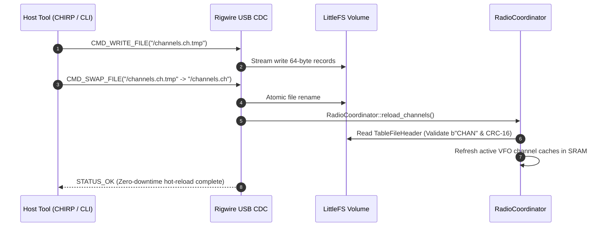

# OpenRadio Storage & Database Specification (ORDS-01)
### Universal, Zero-Allocation, Power-of-Two Storage Architecture for Open-Source Amateur Radio Firmwares

---

## 1. Preamble & Motivation

Amateur radio firmware development has historically suffered from extreme fragmentation. Every radio manufacturer (Motorola, Anytone, TYT, Baofeng, Quansheng) and every open-source firmware project (OpenGD77, Hawk5, Fagci `k1-fw`, DeltaFW, CEC) has invented proprietary, ad-hoc binary blobs for storing channels and configuration.

### 1.1. The Critical Flaws of Existing Implementations

| Firmware / Paradigm | Storage Engine | Record Geometry | Multi-App Extensibility | Safety & Regulatory | Deletion & Allocation | Integrity & Versioning |
| :--- | :--- | :--- | :--- | :--- | :--- | :--- |
| **Stock Quansheng / Baofeng** | Raw I2C EEPROM | Disjoint tables at 3 disparate offsets (`0x0000`, `0x0D60`, `0x0F50`). Reading 1 channel requires 3 separate I2C bus transactions. | **None**. Hardcoded 200 analog FM channels with 10-char ASCII names. | None. Radios blindly transmit on unauthorized frequencies if commanded. | Zeroing out frequency fields; no allocation tracking. | **None**. No magic bytes, no versioning, no checksums. Power loss during write causes silent data corruption. |
| **OpenGD77** | Monolithic binary codeplug in EEPROM/Flash | Fixed DMR struct offsets. Non-power-of-two record sizes. | **None**. Rigidly tied to DMR (Timeslot, Color Code, TG lists). Cannot support mesh, APRS, or satellite metadata without breaking format. | Hardcoded band limits compiled into C binary. | Linear scans; rewriting entire multi-kilobyte tables. | Single version byte, but minor schema changes break existing user codeplugs. |
| **OpenRTX (OBCF / `.rtxc`)** | Single monolithic `.rtxc` file (`header\|contacts\|channels\|bank_offsets\|banks`) | **Variable-length records by mode**: M17 contact (41B) vs DMR contact (38B); FM channel (85B) vs DMR (89B) vs M17 (90B). Unaligned odd sizes. | **Rigid**. Hardcoded exclusively to FM, DMR, and M17. Cannot support mesh, CW, AM, SSB, satellite, or APRS without breaking file offsets. | None in file format; soft checks in CPS. | **Zero $O(1)$ random seek**. Reading Channel $N$ requires sequentially parsing all preceding contacts and channels. Fragile bank pointer tables (`uint32_t[n]` + `uint16_t[n]`). | Single version number (`uint16_t`). CTCSS relies on a 50-entry table; **zero support for DCS** or 1750 Hz tone bursts. |
| **Hawk5 / Fagci `k1-fw`** | LittleFS flat files (`Bands.bnd`, `Settings.set`, `vfos.vfo`) | Packed C structs with **compiler bitfields** (`rxF: 27`, `ppm: 5`). Unaligned struct sizes (36B, 44B) that cross flash page boundaries. | Unions hacked inside channel struct (`meta.type = TYPE_BAND`). | Soft bounds in C functions. | Linear search; shifting records down. | **No file headers** in `storage.c`. Changing struct size by 1 byte permanently scrambles existing databases. |
| **DeltaFW** | LittleFS flat files | Variable C structs; relies on global in-RAM structures (`gEeprom`). | Decoupled apps, but lacks structured binary database abstraction. | Ad-hoc checks. | Linear scan. | CRC on some files, but no universal record header. |
| **OpenRadio (ORDS-01)** | **Native LittleFS + Zero-Heap `TableDb`** | **Strict Power-of-Two ($2^N$ Bytes)**: 64B (`.ch`), 32B (`.ct`, `.bnd`, `.hit`, `.zn`), 16B (`.fm`, header), 160B (`.vfo`), 512B (`/sys/calib.dat`). Zero sector straddling. | **Modular & Extensible**: App-managed generic 16-byte container (`user_tag`) + dynamic `ModulationProfile` (FM, AM, AMB, USB, DSB, CW, WFM, PacketFM, Raw). | **Declarative `.bnd` Band Plans** enforcing legal TX locks, auto-tuning, and transmitter geolocation (`geo_t`). | **$O(1)$ Bit-Shift Random Access** (`16 + (i << 6)`) + $O(1)$ `SlotBitmap` allocator. 16-bit `bank_mask` (zero-overhead bank membership). | **16-byte `TableFileHeader`** with FourCC format identifier, version, record stride verification, CCITT CRC-16, and LittleFS custom attributes. Direct 16-bit `SubAudible` (CTCSS 0.1Hz, DCS Normal/Inverted, 1750Hz). |

### 1.2. Design Objectives for Universal Adoption
This standard is created to serve not only `kern`, but also as a clean, referenceable specification that **OpenGD77, M17 OpenHT, RadSens, CHIRP Next, and future SDR radio projects** can adopt as a universal foundation.

### 1.3. In-Depth Technical Critique: OpenRTX Binary CPS Format (OBCF) vs. ORDS-01

The OpenRTX project attempted an open binary codeplug format (`.rtxc`), but its implementation suffers from fundamental architectural flaws that make it unsuitable for performant embedded execution:

1. **Monolithic Sequential Packing vs. Independent Filesystem Separation**:
   - *OpenRTX Flaw*: OBCF packs `|header|contacts|channels|bank offsets|banks|` sequentially into a single file. Inserting or modifying a single contact shifts the byte offsets of every channel and bank in the file, forcing full flash rewrites and risking corruption.
   - *ORDS-01 Solution*: Files are decoupled natively on LittleFS (`/user/channels.ch`, `/user/contacts.ct`, `/user/bandplan.bnd`). Modifying contacts never touches or shifts channel tables.
2. **Variable-Length Mode Records vs. Constant Power-of-Two Stride**:
   - *OpenRTX Flaw*: In OBCF, record sizes vary by mode: M17 contacts are 41 bytes while DMR contacts are 38 bytes; FM channels are 85 bytes, DMR channels are 89 bytes, and M17 channels are 90 bytes. **This completely destroys $O(1)$ random seek**. To read Channel 50, an MCU must sequentially read and parse Channels 0 through 49 from SPI flash!
   - *ORDS-01 Solution*: Channels are strictly **64 bytes** ($2^6$) and Contacts are strictly **32 bytes** ($2^5$). Seeking to record $i$ is calculated via bitwise shift: `offset = 16 + (i << 6)`. Zero sequential parsing, zero read amplification.
3. **Fragile Bank Indirection Tables vs. 16-Bit Zone Masking**:
   - *OpenRTX Flaw*: OBCF defines variable-length Bank structures containing arrays of channel indices (`uint16_t[n]`), preceded by an auxiliary `bank offsets` array (`uint32_t[n]`). Adding or reordering a channel in a bank requires recalculating all bank offsets and rewriting the file's tail.
   - *ORDS-01 Solution*: A 16-bit `bank_mask` inside `ChannelRecord` grants instant, zero-overhead membership across up to 16 zones simultaneously with zero pointer tables and zero file modifications.
4. **CTCSS Index Table vs. Mathematical Direct `SubAudible`**:
   - *OpenRTX Flaw*: CTCSS frequencies are represented as arbitrary indices into a 50-item lookup table with a bitwise flag. It provides **zero support for DCS (Digital Coded Squelch)** or European 1750 Hz tone bursts.
   - *ORDS-01 Solution*: `SubAudible` encodes continuous 0.1 Hz CTCSS (no lookup table needed), DCS Normal (octal), DCS Inverted, and European Tone Bursts directly in a single 16-bit scalar.
5. **Mode Rigidness vs. Dynamic Modulation Profiles**:
   - *OpenRTX Flaw*: Hardcoded exclusively to FM, DMR, and M17. Adding CW Morse, SSB, AM Airband, Hermes Mesh, APRS packet, or SSTV breaks the entire file format.
   - *ORDS-01 Solution*: Fully decoupled: an opaque 16-byte `user_tag` for private app metadata, combined with generic `ModulationProfile` descriptors arbitrated dynamically by the radio service.

---

## 2. Fundamental Architectural Tenets

1. **Native LittleFS Direct Storage (Zero Container Overhead)**:
   - We **strictly avoid artificial container/archive formats** (no `.tar`, `.zip`, or monolithic `.cplg` wrappers).
   - LittleFS already provides an industrial-grade, power-fail-resilient, wear-leveling filesystem with hierarchical directories and file metadata.
   - Wrapping files inside an archive on microcontrollers adds unnecessary RAM unpacking buffers, redundant directory parsing, and eliminates direct $O(1)$ random-access seeking.
   - Files reside directly in the LittleFS volume: `/user/channels.ch`, `/user/contacts.ct`, `/user/bandplan.bnd`, `/user/vfo_a.vfo`, etc.
2. **Strict Power-of-Two Record Alignment ($2^N$ Bytes)**:
   - Channel records: strictly **64 bytes** ($2^6$).
   - Contact, Band Plan, Scanner Hit, and Zone records: strictly **32 bytes** ($2^5$).
   - FM Broadcast records and Table Headers: strictly **16 bytes** ($2^4$).
   - Hardware Capabilities: strictly **64 bytes** ($2^6$).
   - **Zero Division**: Index math on Cortex-M0+ / M4 microcontrollers uses pure bitwise shifts: `offset = HEADER_SIZE + (index << STRIDE_SHIFT)`.
   - **Zero Flash Sector Straddling**: Inside standard 4096-byte LittleFS sectors, exactly $2^{12-N}$ records fit without ever crossing a 4KB sector boundary or 256-byte page boundary.
3. **Deterministic Little-Endian Wire Format**:
   - Zero compiler-dependent bitfields. All fields use explicit scalar types (`u8`, `u16`, `u32`, `i16`, `i32`) with well-defined bitmasks.
   - Binary representations are 100% identical across ARM GCC, Rust `no_std`, Python, WebAssembly, and host PC tools.
4. **$O(1)$ Slot Allocation Bitmap (`SlotBitmap`)**:
   - An allocation bitmap (256 bits = 32 bytes) enables instant $O(1)$ free slot discovery via Cortex-M0+ hardware `trailing_zeros()`.
   - Channel deletion is instant ($O(1)$) by clearing a bit in the bitmap (tombstone), eliminating flash wear caused by rewriting records.
5. **Decoupled Declarative Extensibility**:
   - Rather than forcing digital, mesh, satellite, and scanner metadata into a monolithic bloated struct, records provide a **16-byte Tagged Extension Block** (`ChannelExtension`).
   - Apps consume and mutate their own domain-specific extensions declaratively without schema migrations.
6. **No Proprietary `.db` or Branded Prefixes**:
   - Files use natural, unambiguous extensions: `.ch`, `.ct`, `.bnd`, `.vfo`, `.hit`, `.zn`, `.fm`, `.cfg`, `.cap`.
   - Format identifiers use clean, unbranded FourCC tags: `CHAN`, `CONT`, `BNDP`, `VFO `, `HITS`, `ZONE`, `FMBC`, `RCAP`.

---

## 3. Power-of-Two Record Hierarchy Overview

```
┌──────────────────────────────────────────────────────────────────────────────────┐
│                           Record Taxonomy & Geometries                           │
├────────────────────┬──────────────┬──────────────┬──────────────┬────────────────┤
│ File Extension     │ FourCC Ident │ Record Size  │ Shift ($N$)  │ Records / 4KB  │
├────────────────────┼──────────────┼──────────────┼───────────────────────────────┤
│ Table Header       │ Any          │ 16 bytes     │ 4 (1 << 4)   │ N/A (Header)   │
│ .fm (FM Broadcast) │ b"FMBC"      │ 16 bytes     │ 4 (1 << 4)   │ 256 records    │
│ .ct (Contacts)     │ b"CONT"      │ 32 bytes     │ 5 (1 << 5)   │ 128 records    │
│ .bnd (Band Plans)  │ b"BNDP"      │ 32 bytes     │ 5 (1 << 5)   │ 128 records    │
│ .hit (Scanner Log) │ b"HITS"      │ 32 bytes     │ 5 (1 << 5)   │ 128 records    │
│ .zn (Zones/Banks)  │ b"ZONE"      │ 32 bytes     │ 5 (1 << 5)   │ 128 records    │
│ .ch (Channels)     │ b"CHAN"      │ 64 bytes     │ 6 (1 << 6)   │ 64 records     │
│ .cap (Cap Manifest)│ b"RCAP"      │ 64 bytes     │ 6 (1 << 6)   │ 64 records     │
│ .vfo (VFO State)   │ b"VFO "      │ 160 bytes    │ Composite    │ Dedicated File │
│ /pref/*.cfg        │ N/A          │ CRC-protected│ Modular      │ Per-subsystem  │
│ /sys/calib.dat     │ b"CLBS"(sig) │ 512 bytes    │ Hardware-MAC │ Silicon-bound  │
└────────────────────┴──────────────┴──────────────┴──────────────┴────────────────┘
```

---

## 4. Common Table File Header (`TableFileHeader`, 16 Bytes)

Every structured table file begins with an identical packed 16-byte header:

```rust
#[repr(C, packed)]
pub struct TableFileHeader {
    pub ident: [u8; 4],         // FourCC format identifier (e.g. b"CHAN", b"CONT", b"BNDP")
    pub version: u16,           // Format version: major.minor (0x0100 for v1.0)
    pub record_count: u16,      // Number of active, populated records (little-endian)
    pub max_records: u16,       // Maximum record capacity allocated in file (little-endian)
    pub record_stride: u16,     // Exact size of each record in bytes (16, 32, or 64)
    pub flags: u8,              // Header flags (Bit 0 = Has SlotBitmap, Bit 1 = Sorted, Bit 2 = Read-Only)
    pub active_bank: u8,        // Active bank/zone selector (default 0)
    pub crc16: u16,             // CCITT CRC-16 over all record payload data
}
```

### Binary Header Wire Diagram
```
 0                   1                   2                   3
 0 1 2 3 4 5 6 7 8 9 0 1 2 3 4 5 6 7 8 9 0 1 2 3 4 5 6 7 8 9 0 1
+-+-+-+-+-+-+-+-+-+-+-+-+-+-+-+-+-+-+-+-+-+-+-+-+-+-+-+-+-+-+-+-+
|                      FourCC Format Identifier                 |
+-+-+-+-+-+-+-+-+-+-+-+-+-+-+-+-+-+-+-+-+-+-+-+-+-+-+-+-+-+-+-+-+
|            Version            |          Record Count         |
+-+-+-+-+-+-+-+-+-+-+-+-+-+-+-+-+-+-+-+-+-+-+-+-+-+-+-+-+-+-+-+-+
|          Max Records          |         Record Stride         |
+-+-+-+-+-+-+-+-+-+-+-+-+-+-+-+-+-+-+-+-+-+-+-+-+-+-+-+-+-+-+-+-+
|     Flags     |  Active Bank  |             CRC-16            |
+-+-+-+-+-+-+-+-+-+-+-+-+-+-+-+-+-+-+-+-+-+-+-+-+-+-+-+-+-+-+-+-+
```

---

## 5. Channel Record Format (`ChannelRecord`, 64 Bytes)

Channels represent memory channel slots (MR mode). Each record is strictly **64 bytes** ($2^6$), matching the normative Keel v0.5.0 specification.

### 5.1. Struct Definition & Wire Layout

```rust
#[repr(C, packed)]
pub struct ChannelRecord {
    // --- Frequency & Tuning (8 bytes) ---
    pub rx_frequency_hz: u32,        // RX frequency in Hz (18_000_000 .. 1_300_000_000)
    pub tx_frequency_hz: u32,        // TX frequency in Hz (0 = Simplex: TX matches RX)

    // --- RF & Modulation Parameters (6 bytes) ---
    pub step_hz_x10: u16,            // Raster step in 10 Hz units (e.g. 1250 = 12.5 kHz, 833 = 8.33 kHz)
    pub bandwidth_50hz: u16,         // IF bandwidth in 50 Hz units (0 = profile default, 25..4000)
    pub modulation: u8,              // Mode enum: 0=FM, 1=AM, 2=AMB, 3=USB, 4=LSB, 5=DSB, 6=CW, 7=WFM, 8=DIG, 9=RAW, 10=BYP
    pub squelch_level: u8,           // Squelch sensitivity: 0 = Open / Carrier, 1..9 = Calibrated threshold

    // --- Subaudible Signaling (4 bytes) ---
    pub rx_subaudible: u16,          // RX CTCSS / DCS / Tone code (see Section 5.3)
    pub tx_subaudible: u16,          // TX CTCSS / DCS / Tone code

    // --- Zone & Option Flags (4 bytes) ---
    pub zone_mask: u16,              // 16-Zone membership bitmask (Bits 0..15 = Zones 1..16)
    pub flags: u16,                  // Operational flags (Scan Skip, TX Inhibit, BCLO, Reverse, etc.)

    // --- Power, Protocol Indirection & Identity (7 bytes) ---
    pub power_mw: u16,               // TX power in mW (0 = profile default, e.g. 5000 mW)
    pub proto: u8,                   // 0 none; 1..15 static; 16..127 persistent (.reg); 128..255 session
    pub proto_ref: u16,              // Protocol-specific reference parameter
    pub uid: u16,                    // Stable channel identity (1..65534; 0 = unassigned)

    // --- Direct Hardware Audio Block (9 bytes, matching BK4829 physical controls) ---
    pub scram_mode: u8,              // 0 off; 1 voice inversion; 2 rolling code
    pub scram_param: u8,             // Inversion: freq/100 Hz in [20, 70] (2-7 kHz); Rolling: key 1-255
    pub scram_hop: u8,               // Rolling hop rate 1-50 Hz (0 = radio default)
    pub compand: u8,                 // Audio compander: 0 off, 1 on
    pub mic_gain: u8,                // Microphone gain in half-dB units 1-72 (0 = radio default)
    pub ste: u8,                     // Squelch Tail Elimination: 0 off, 1=55Hz, 2=120Hz, 3=180Hz
    pub roger: u8,                   // Radio-local roger profile hint (0-15, 0 = default)
    pub tx_limit: u8,                // TX deviation clamp in 50 Hz steps (0 = none, 10..100 = 0.5..5.0 kHz)
    pub audio_flags: u8,             // bit 0 HPF, bit 1 pre-emphasis; bits 2-7 reserved zero

    // --- Name & Alphanumerics (16 bytes) ---
    pub name: [u8; 16],              // Channel label (UTF-8, null-padded)

    // --- Declarative Tagged Extension Block (8 bytes) ---
    pub user_tag: [u8; 8],           // FourCC Tagged Extension Container (FourCC + version + 3B payload)

    // --- Record Integrity (2 bytes) ---
    pub record_crc: u16,             // CRC-16/CCITT-FALSE over bytes [0..0x3E)
}
```

### 5.2. Channel Flags Bitmask (`flags: u16`)

```rust
pub struct ChannelFlags;
impl ChannelFlags {
    pub const BUSY_LOCKOUT: u16    = 1 << 0;  // Inhibit transmission if carrier/squelch is active
    pub const SCAN_SKIP: u16       = 1 << 1;  // Skip this channel during VFO / Zone scanning
    pub const REVERSE: u16         = 1 << 2;  // Swap RX and TX frequencies (listen on repeater input)
    pub const PRIORITY_1: u16      = 1 << 3;  // Primary priority channel for Dual/Triple watch
    pub const PRIORITY_2: u16      = 1 << 4;  // Secondary priority channel
    pub const TX_INHIBIT: u16      = 1 << 5;  // Receive-Only channel (PTT strictly disabled)
    // Bit 6 retired (compander moved to audio block)
    pub const PTT_ID_START: u16    = 1 << 7;  // Send ANI/MDC1200 ID at start of transmission
    pub const PTT_ID_END: u16      = 1 << 8;  // Send ANI/MDC1200 ID at end of transmission
    pub const TALKAROUND: u16      = 1 << 9;  // Transmit on repeater output frequency (simplex bypass)
    pub const FAVORITE: u16        = 1 << 10; // Fast-access favorite mark
    // Bits 11-12 retired (HPF and pre-emphasis moved to audio block audio_flags)
    pub const WIDE_FILTER: u16     = 1 << 13; // Hardware IF filter selection override
}
```

### 5.3. Subaudible Signaling Standard (`rx_subaudible`, `tx_subaudible`: `u16`)

Subaudible signaling handles analog CTCSS tones, digital DCS codes, and European repeater access tone bursts in a single 16-bit integer without floating-point math:

```
┌────────────────────────────────────────────────────────────────────────────────────────┐
│ Range (Hex)         │ Type               │ Representation                              │
├─────────────────────┼────────────────────┼─────────────────────────────────────────────┤
│ 0x0000              │ None / Disabled    │ Tone squelch inactive                       │
│ 0x0001 .. 0x0FFF    │ CTCSS Tone         │ Frequency in 0.1 Hz units (e.g. 670=67.0Hz, │
│                     │                    │ 885=88.5Hz, 2541=254.1Hz)                   │
├─────────────────────┼────────────────────┼─────────────────────────────────────────────┤
│ 0x1000 .. 0x11FF    │ DCS Normal (DxxxN) │ Bits 0..8 = Octal code (e.g. 023 = 0x1013)  │
├─────────────────────┼────────────────────┼─────────────────────────────────────────────┤
│ 0x2000 .. 0x21FF    │ DCS Invert (DxxxI) │ Bits 0..8 = Octal code (e.g. 023 = 0x2013)  │
├─────────────────────┼────────────────────┼─────────────────────────────────────────────┤
│ 0x3000 .. 0x300F    │ Repeater Burst     │ 0x3001 = 1750 Hz, 0x3002 = 2100 Hz,         │
│                     │                    │ 0x3003 = 1450 Hz                            │
└────────────────────────────────────────────────────────────────────────────────────────┘
```

### 5.4. Generic 16-Byte Application Extension Container (`user_tag`)

The 16-byte `user_tag` field provides a clean, zero-migration extension container allowing applications to attach private operational metadata to channels. Rather than hardcoding rigid schemas in the core storage standard, **individual applications own their payload interpretation**:

```rust
#[repr(C, packed)]
pub struct ChannelExtension {
    pub tag: [u8; 4],                // FourCC schema tag registered by the owning app
    pub payload: [u8; 12],           // 12 bytes of opaque application-managed payload
}
```

- **App Ownership**: When an application (e.g. `HermesApp`, `AprsApp`, `ScannerApp`) is active, it inspects `tag`. If the tag matches the app's registered FourCC identifier (e.g. `b"HRMS"`, `b"APRS"`, `b"SCAN"`), the app decodes the 12-byte payload.
- **Universal Storage Stability**: Because the core storage layer treats `payload` as opaque bytes, adding or modifying application features never breaks channel database compatibility across firmware revisions or third-party tools.

---

### 5.5. Generic Modulation & RF Mode Profile Architecture

In advanced amateur radio firmwares, "Mode" is more than just a modulation label—it dictates the physical RF frontend tuning, baseband DSP audio filtering, AGC dynamics, squelch qualification, and audio routing across the radio.

Rather than hardcoding radio behaviors per modulation, `kern` specifies a **Modular RF Mode Profile Architecture** (`ModulationProfile`) managed flexibly by applications and arbitrated by the radio coordinator:

```rust
/// Baseband audio routing policies for RF modes.
#[derive(Debug, Clone, Copy, PartialEq, Eq)]
pub enum AudioRoutingPolicy {
    Speaker,             // Demodulated voice routed to speaker/headphones on squelch open
    BasebandModem,       // Audio silenced from speaker; piped to FSK/DMA modem buffers
    DiscriminatorTap,    // Raw discriminator audio tapped for external decoders (pin PB1 / USB)
    Muted,               // Completely silenced regardless of carrier
}

/// Comprehensive, generic RF mode descriptor defining the physical, audio,
/// AGC, filtering, and squelch requirements of a modulation scheme.
#[derive(Debug, Clone, Copy, PartialEq, Eq)]
pub struct ModulationProfile {
    pub mode: ModulationMode,             // FM, AM, AM-Baseband, USB, DSB, CW, WFM, PacketFM, Raw, Bypass
    pub default_bandwidth: Bandwidth,     // Narrow (12.5k), Wide (25.0k), Very Narrow (6.25k)
    pub af_response: AfResponse,          // Pre/De-emphasis, High-Pass (HPF), Low-Pass (LPF)
    pub audio_routing: AudioRoutingPolicy,// Speaker vs Baseband Modem vs Discriminator Tap
    pub squelch_type: SquelchType,        // Carrier, CTCSS, DCS, or Digital Sync Word Match
    pub agc_mode: AgcListeningMode,       // FM, AM Listening, or SSB
    pub agc_speed: AgcSpeed,              // Fast, Medium, or Slow
    pub bfo_offset_hz: i16,               // BFO injection pitch (+700 Hz for CW, +1500 Hz for USB)
    pub default_step_hz: u32,             // Standard channel raster step (500 Hz .. 50 kHz)
}
```

#### What Each Modulation Entails Across the Radio Pipeline

| Modulation Mode | Bandwidth | Audio Shaping (DSP) | Audio Routing | AGC Dynamics | BFO Pitch | Typical Applications & Squelch |
| :--- | :--- | :--- | :--- | :--- | :--- | :--- |
| **`Fm`** | Narrow 12.5k | Voice De-emphasis (300Hz HPF, 3kHz LPF) | `Speaker` | Medium / FM | None | Voice Repeaters & Simplex (Noise/CTCSS squelch) |
| **`Am`** | Narrow 12.5k | Flat audio (100Hz HPF, 3.5kHz LPF) | `Speaker` | Slow / AM | None | Civil Aviation & Shortwave (Carrier squelch) |
| **`AmB`** | Narrow 12.5k | Active baseband AGC demodulator | `Speaker` | Slow / AM | None | Weak-signal Airband with dynamic AGC tracking |
| **`Usb` / `Dsb`** | VeryNarrow 6.25k | 300Hz HPF, 2.8kHz LPF | `Speaker` | Fast / SSB | +1500 Hz | SSB voice & weak signals (Open/Manual squelch) |
| **`Cw`** | VeryNarrow 6.25k | Narrow bandpass (500Hz HPF, 900Hz LPF) | `Speaker` | Fast / SSB | +700 Hz | Morse code with clean sidetone injection |
| **`Wfm`** | Wide 25k (150k) | Broadcast 50us/75us de-emphasis | `Speaker` | Medium / FM | None | Commercial Broadcast Radio 64–108 MHz |
| **`PktFm`** | Narrow 12.5k | **Flat response (Pre/De-emphasis BYPASSED)** | `BasebandModem`| Fast / FM | None | APRS, Packet 1200/9600, SSTV, M17, Hermes |
| **`Raw`** | Wide 25k | Raw discriminator unfiltered audio | `DiscriminatorTap`| Fixed / Manual | None | External hardware TNC, pager decoders, SDR taps |
| **`Byp`** | Wide 25k | Demodulator bypass tapped at baseband | `BasebandModem`| Fixed / Manual | None | Software-defined demodulators & fast digital modes |

#### Application Management & Arbitration Integration

Just as `RadioCoordinator` provides fine-grained arbitration via client tokens (`ClientId`), resource masks (`RfResourceMask`), and priority tiers (`LockTier`), **RF modes are arbitrated dynamically**:
1. **Default Profiles**: The radio service provides standard profiles out of the box via `ModulationMode::default_profile()`.
2. **App-Driven Mode Customization**: When an application (e.g. `AprsApp`, `SstvApp`, `AirbandApp`, `CwApp`) takes foreground or background focus, it can supply a custom `ModulationProfile` override.
3. **Hardware Delegation**: The `RadioCoordinator::apply_modulation_profile(&mut radio, slot, &profile)` method coordinates the hardware registers—configuring modulation, filter bandwidth, AF equalization, AGC speed, and audio routing—without embedding application-specific logic into the radio driver.


---

## 6. Contact Directory Record (`ContactRecord`, 32 Bytes)

Contacts store digital identities, DMR talkgroups, Hermes mesh peers, and speed-dial destinations. Each record is strictly **32 bytes** ($2^5$).

```rust
#[repr(C, packed)]
pub struct ContactRecord {
    pub address: [u8; 6],            // 48-bit address (MAC, Hermes Node ID, M17 Base40, DMR ID)
    pub contact_type: u8,            // Protocol Type: 0=Generic, 1=Hermes, 2=M17, 3=APRS, 4=DMR, 5=MDC1200, 6=SelCall, 7=DTMF
    pub call_type: u8,               // Call Target: 0=Private, 1=Group/Talkgroup, 2=Broadcast, 3=Emergency
    pub name: [u8; 14],              // Friendly contact name or callsign (UTF-8, null-padded)
    pub sub_id: u16,                 // Sub-identity / Talkgroup ID / SelCall sequence
    pub flags: u16,                  // Bit 0=Mute until match, Bit 1=Favorite, Bit 2=Active Neighbor, Bit 3=Encrypted, Bit 4=Auto-ACK
    pub last_rssi_dbm: i8,           // Telemetry: Last heard signal strength in dBm (-128 if unknown)
    pub battery_metric: u8,          // Telemetry: Peer battery state of charge (0..100%, 255=unknown)
    pub role_capabilities: u8,       // Mesh role: 0=Client, 1=Router, 2=Tracker, 3=Gateway
    pub lqi: u8,                     // Link Quality Indicator: 0..255 (Packet delivery ratio)
    pub reserved: [u8; 2],           // Future alignment
}
```

---

## 7. High-Capacity Flash Binary Search Index (`IndexRecord`, 16 Bytes)

On microcontrollers with only 16 KB of SRAM, loading 200,000+ worldwide DMR contact records (e.g. RadioID.net database) into RAM is physically impossible. 

`kern` specifies an **$O(\log N)$ Flash-Sorted Index** in `/contacts.idx` (`b"INDX"`). Each index entry is strictly **16 bytes** ($2^4$):

```rust
#[repr(C, packed)]
pub struct IndexRecord {
    pub key: u32,                    // Monotonically sorted 32-bit DMR ID or FNV-1a Hash of Callsign
    pub record_offset: u32,          // Byte offset of full ContactRecord in /contacts.ct
    pub reserved: [u8; 8],           // Future expansion
}
```

### 7.1. Zero-RAM Flash Binary Search Algorithm
Because the index is strictly sorted on SPI Flash:
$$\text{Max SPI Reads} = \lceil \log_2(200,000) \rceil = 18 \text{ iterations}$$
- Each iteration performs a 16-byte SPI read directly into a local stack buffer.
- Total bytes transferred over SPI: $18 \times 16 = 288\text{ bytes}$ ($< 1.2\text{ ms}$).
- **RAM Overhead**: Exactly **16 bytes** of SRAM!

---

## 8. Band Plan & Regulatory Safety Engine (`BandPlanRecord`, 32 Bytes)

Band plans provide **declarative RF safety and intelligent auto-tuning**. When tuning in VFO mode or sweeping with the spectrum analyzer, the radio looks up the active band in `/bandplan.bnd` (`b"BNDP"`) to automatically configure raster step, modulation, bandwidth, and legal transmission permissions:

```rust
#[repr(C, packed)]
pub struct BandPlanRecord {
    pub min_frequency_hz: u32,       // Lower frequency boundary in Hz (e.g. 144_000_000)
    pub max_frequency_hz: u32,       // Upper frequency boundary in Hz (e.g. 148_000_000)
    pub default_step_khz_x100: u16,  // Default channel spacing (e.g. 1250 = 12.5 kHz, 833 = 8.33 kHz)
    pub default_bandwidth: u8,       // Default bandwidth: 0 = Narrow, 1 = Wide
    pub default_modulation: u8,      // Default modulation: 0 = FM, 1 = AM, 2 = USB, 3 = LSB, 4 = CW, 5 = WFM
    pub max_power_level: u8,         // Maximum legal RF power: 0 = Low, 1 = Mid, 2 = High, 255 = TX Prohibited
    pub regulatory_flags: u16,       // Regulatory bitmask (see Section 8.1)
    pub name: [u8; 12],              // Band label (e.g. "2M HAM\0\0\0\0\0\0", "AIRBAND\0\0\0\0\0")
    pub default_squelch: u8,         // Recommended squelch level (1..9)
    pub default_scanlist_id: u8,     // Scanlist/Zone group associated with this band
    pub reserved: [u8; 4],           // Alignment to 32 bytes
}
```

### 8.1. Regulatory Flags (`regulatory_flags: u16`)

```rust
pub struct RegulatoryFlags;
impl RegulatoryFlags {
    pub const TX_PERMITTED: u16       = 1 << 0;  // Radio PA is permitted to key within these bounds
    pub const HAM_AMATEUR: u16        = 1 << 1;  // Amateur radio band (licensed amateur privileges)
    pub const AIRBAND_AM: u16         = 1 << 2;  // Civil Aviation VHF (Strict AM, 8.33/25kHz raster, TX strictly locked)
    pub const MARINE_VHF: u16         = 1 << 3;  // Maritime Mobile Service
    pub const PMR_FRS_LICENSE_FREE: u16= 1 << 4; // License-free PMR446 / FRS / GMRS
    pub const BROADCAST_RX_ONLY: u16  = 1 << 5;  // Commercial FM/AM broadcast (TX strictly forbidden)
    pub const EMERGENCY_DISTRESS: u16 = 1 << 6;  // Emergency distress channels (121.5 MHz, 156.8 MHz, 243.0 MHz)
    pub const REPEATER_SUBBAND: u16   = 1 << 7;  // Sub-band reserved for repeater inputs/outputs
    pub const SATELLITE_SUBBAND: u16  = 1 << 8;  // Sub-band reserved for amateur satellite communication
    pub const DIGITAL_MODES_ONLY: u16 = 1 << 9;  // Preferred digital / packet / data sub-band
    pub const CW_ONLY: u16            = 1 << 10; // Morse code exclusive sub-band
}
```

---

## 9. Hardware Capability Manifest (`RadioCapRecord`, 64 Bytes / `.cap`)

To prevent users from flashing dangerous or incompatible codeplugs (e.g. attempting to transmit on 220 MHz on hardware lacking a 1.25m low-pass filter), each radio exports its physical capabilities in `/hardware.cap` (`b"RCAP"`). Rather than using brittle hardcoded bitfields for expansion peripherals, hardware components and auxiliary drivers are declared cleanly:

```rust
#[repr(C, packed)]
pub struct PeripheralDescriptor {
    pub driver_class: u8,           // 0=None, 1=RfTuner, 2=FmBroadcast, 3=GnssGps, 4=BleWireless, 5=RtcTimer, 6=Display
    pub driver_id: u8,              // e.g. 0x01=BK4819, 0x02=SI4732, 0x03=BK1080, 0x04=NMEA_GPS, 0x05=NUS_BLE
    pub bus_type: u8,               // 0=Internal/MemoryMapped, 1=I2C, 2=SPI, 3=UART, 4=USB
    pub bus_address: u8,            // 7-bit I2C slave address or SPI CS pin / UART port index
}

#[repr(C, packed)]
pub struct RadioCapRecord {
    pub ident: [u8; 4],              // FourCC format identifier: b"RCAP"
    pub version: u16,                // 0x0100
    pub hardware_id: u16,            // Target Board ID (0x0001 = UV-K1 / K5 v3, 0x0002 = OpenHT)
    
    // --- Frequency Tunability (16 bytes) ---
    pub rx_min_hz: u32,              // Hardware absolute minimum RX frequency (e.g. 18_000_000)
    pub rx_max_hz: u32,              // Hardware absolute maximum RX frequency (e.g. 1_300_000_000)
    pub tx_min_hz: u32,              // Hardware absolute minimum TX frequency (e.g. 136_000_000)
    pub tx_max_hz: u32,              // Hardware absolute maximum TX frequency (e.g. 480_000_000)
    
    // --- RF Frontend & Capabilities (8 bytes) ---
    pub supported_modulations: u16,  // Bitmask: FM, AM, USB, LSB, CW, WFM, RAW
    pub max_tx_power_mw: u16,        // Maximum safe transmitter output (e.g. 5000 mW, 10000 mW)
    pub tx_filter_bands_mask: u8,    // Hardware PA filter bands present (VHF, 220M, UHF)
    pub max_channels: u16,           // Maximum storage capacity (e.g. 512)
    pub max_contacts: u16,           // Maximum contacts capacity (e.g. 256)
    
    // --- Declarative Modular Peripherals (16 bytes) ---
    pub peripherals: [PeripheralDescriptor; 4], // Active peripheral hardware instances
    
    // --- System Resources (4 bytes) ---
    pub flash_size_kb: u16,          // Total SPI Flash volume (e.g. 2048 KB)
    pub sram_size_kb: u16,           // MCU internal SRAM (e.g. 16 KB)
    
    pub reserved: [u8; 12],          // Alignment to 64 bytes
}
```

---

## 10. VFO Runtime Scratchpad & Instant Boot (`.vfo`, 160 Bytes)

### 10.1. Flash Longevity vs. Fast Boot Duality

Continuous rotary-encoder tuning in VFO mode rapidly destroys NOR flash sectors if every frequency change is written to disk. 

`kern` solves this via a **two-tier memory model**:
1. **Volatile SRAM Tier**: All frequency changes, cursor adjustments, and dual-watch state updates occur strictly in SRAM.
2. **Snapshot Persistence Tier**: Upon power-down detection (monitoring ADC battery rail collapse) or after a 10-second idle period, the runtime state is committed into `/vfo.vfo` (or individual `/user/vfo_a.vfo` / `/user/vfo_b.vfo`) using format identifier `b"VFO "`.
3. **Sub-2ms Cold Boot Recovery**: On power-up, the radio loads `/vfo.vfo` in **< 1.8 milliseconds**, immediately restoring frequencies, active memory channel indices, and LCD cursor positions without scanning large channel tables.

### 10.2. Binary Layout (`.vfo`)

```rust
#[repr(C, packed)]
pub struct VfoSnapshotHeader {
    pub ident: [u8; 4],              // FourCC identifier: b"VFO " (0x204F4656)
    pub version: u16,                // 0x0100 (v1.0)
    pub active_vfo_index: u8,        // 0 = VFO A, 1 = VFO B
    pub dual_watch_mode: u8,         // 0 = Single, 1 = Dual Watch, 2 = Cross-Band, 3 = Triple Watch
    pub vfo_a_mode: u8,              // 0 = Frequency Mode (VFO), 1 = Channel Mode (MR)
    pub vfo_b_mode: u8,              // 0 = Frequency Mode (VFO), 1 = Channel Mode (MR)
    pub vfo_a_mr_index: u16,         // Active channel index for VFO A if in MR mode (0xFFFF if none)
    pub vfo_b_mr_index: u16,         // Active channel index for VFO B if in MR mode (0xFFFF if none)
    pub active_zone_id: u8,          // Active zone index (0..15)
    pub tuning_digit_cursor: u8,     // Rotary encoder cursor position (100MHz down to 10Hz)
    pub scan_state: u8,              // 0 = Idle, 1 = VFO Scan, 2 = MR Scan, 3 = Zone Scan
    pub flags: u8,                   // Bit 0 = Talkaround, Bit 1 = Reverse, Bit 2 = Monitor
    pub reserved: [u8; 16],          // Future alignment (32 bytes total header)
}

#[repr(C, packed)]
pub struct VfoSnapshot {
    pub header: VfoSnapshotHeader,   // 32 bytes
    pub vfo_a: ChannelRecord,        // 64 bytes
    pub vfo_b: ChannelRecord,        // 64 bytes
}
// Total file size: 32 + 64 + 64 = 160 bytes
```

---

## 11. Scanner / Spectrum Hit & "Loot" Log (`HitRecord`, 32 Bytes)

When the radio runs the **Scanner**, **Spectrum Analyzer**, **LiveSeek**, or **Frequency Counter** apps, active transmissions are detected, measured, and stored in `/hits.hit` (`b"HITS"`). Each hit is strictly **32 bytes** ($2^5$).

```rust
#[repr(C, packed)]
pub struct HitRecord {
    pub frequency_hz: u32,           // Detected active frequency in Hz
    pub timestamp_epoch_or_tick: u32,// Uptime seconds or RTC timestamp of detection
    pub duration_ms: u16,            // Total duration of transmission in milliseconds
    pub peak_rssi_dbm: i8,           // Peak signal strength in dBm
    pub snr_db: u8,                  // Signal-to-Noise Ratio in dB
    pub subaudible_detected: u16,    // Captured tone: CTCSS (0.1 Hz) or DCS code (0 = None)
    pub hit_count: u16,              // Number of times this frequency triggered squelch
    pub flags: u8,                   // Bit 0=Whitelist, Bit 1=Blacklist, Bit 2=Favorite, Bit 3=Auto-stored
    pub signaling_type: u8,          // 0=Analog FM, 1=CTCSS, 2=DCS, 3=MDC1200, 4=DTMF, 5=DMR, 6=M17
    pub preview_data: [u8; 8],       // Decoded data snippet: MDC1200 Unit ID, DTMF digits, or DMR TG
    pub reserved: [u8; 4],           // Alignment to 32 bytes
}
```

---

## 12. Zone & Bank Organization (`ZoneRecord`, 32 Bytes)

Channels are organized into zones/banks without duplicating records. While `ChannelRecord.bank_mask` dictates channel membership across 16 zones, `/zones.zn` (`b"ZONE"`) stores **zone metadata**:

```rust
#[repr(C, packed)]
pub struct ZoneRecord {
    pub name: [u8; 16],              // Zone name (e.g. "LOCAL REPEATERS\0", "AIRPORT TOWER\0\0\0")
    pub zone_id: u8,                 // Zone index: 0..15
    pub priority_ch_1: u16,          // Primary Priority Channel index (0xFFFF = None)
    pub priority_ch_2: u16,          // Secondary Priority Channel index (0xFFFF = None)
    pub scan_dwell_ms: u16,          // Scan dwell time in milliseconds (default 500)
    pub scan_resume_ms: u16,         // Delay before scan resumes after carrier drop (default 2000)
    pub channel_count: u16,          // Cached count of channels belonging to this zone
    pub flags: u16,                  // Bit 0=Auto-resume, Bit 1=Reverse scan, Bit 2=Lockout empty
    pub reserved: [u8; 4],           // Alignment to 32 bytes
}
```

---

## 13. FM Broadcast Radio Memories (`FmStationRecord`, 16 Bytes)

Broadcast FM radio (64.0 – 108.0 MHz) channels are stored in `/broadcast.fm` (`b"FMBC"`). Each record is strictly **16 bytes** ($2^4$):

```rust
#[repr(C, packed)]
pub struct FmStationRecord {
    pub frequency_khz: u32,          // Station frequency in kHz (e.g. 101_100 for 101.10 MHz)
    pub name: [u8; 8],               // RDS Program Service (PS) 8-character station name (e.g. "BBC R4  ")
    pub flags: u8,                   // Bit 0 = Favorite, Bit 1 = Mono override, Bit 2 = RDS enabled
    pub preset_idx: u8,              // Station preset number (1..99)
    pub reserved: [u8; 2],           // Alignment to 16 bytes
}
```

---

## 14. Radio Hardware Calibration & Device Binding (`/sys/calib.dat`, 512 Bytes)

External SPI Flash preserves RF factory calibration parameters in `/sys/calib.dat` protected by cryptographic silicon hardware binding in `/sys/calib.sig`:

### 14.1. Factory Calibration Block (512 Bytes)
- **Squelch Thresholds**: Open/Close RSSI, Noise, and Glitch levels.
- **Power DAC Trims**: Low, Mid, and High transmitter DAC bias per band.
- **Battery Curve ADC Points**: Monotonic voltage baseline table (Word 3 = 7.60V baseline in ADC range 1800..2600).
- **Crystal Oscillator Trim**: XTAL trim at offset `0x188` (`i16`, valid range ±1000 Hz).
- **RF Frontend Gains**: LNA gain (`0x18A`), Mixer gain (`0x18C`), Volume gain (`0x18E`).

### 14.2. Silicon Hardware Binding Signature (`/sys/calib.sig`, 32 Bytes)
To prevent unauthorized cloning or calibration mismatch across distinct MCU silicon, calibration data is bound to the microcontroller's 96-bit Unique Identifier (UID):

```rust
#[repr(C)]
pub struct CalibSignature {
    pub ident: [u8; 4],          // FourCC identifier: b"CLBS"
    pub version: u8,             // 1
    pub _reserved: [u8; 3],      // Alignment padding
    pub hardware_serial: u64,    // 64-bit hardware serial derived from MCU UID
    pub auth_tag: [u8; 16],      // Poly1305 MAC over the 512-byte calibration data
}
```

---

## 15. Native LittleFS Filesystem Scheme & Layout

Instead of wrapping tables inside artificial archive files (`.cplg`, `.tar`) or monolithic blobs, the firmware utilizes the **native LittleFS directory structure** directly.

### 15.1. Why Direct Filesystem Scheme Beats Archive Containers

1. **Zero RAM Decompression Overhead**:
   - Archive formats require unpacking headers or extracting members into RAM buffers.
   - On a 16 KB SRAM microcontroller, there is no RAM available to decompress or parse archive archives.
2. **True $O(1)$ Random Access Directly on Flash**:
   - Accessing record $i$ in `/user/channels.ch` requires a single call:
     ```c
     lfs_file_seek(&file, 16 + (i << 6), LFS_SEEK_SET);
     lfs_file_read(&file, &record, 64);
     ```
   - Total RAM consumed: **0 bytes** (record reads directly into destination struct).
3. **Power-Cut Safety & Atomic Commits via `lfs_rename`**:
   - When a host tool (CHIRP, WebUSB) updates a channel table, it writes `/user/channels.ch.tmp` and executes an **atomic filesystem rename**:
     ```c
     lfs_rename(&lfs, "/user/channels.ch.tmp", "/user/channels.ch");
     ```
   - If power drops at any point during transmission, the active `/user/channels.ch` file remains completely uncorrupted.

### 15.2. Filesystem Hierarchy

The standard filesystem layout organizes operational user data, configuration, and system hardware assets cleanly:

```
/
├── user/
│   ├── channels.ch               # Memory channels (64-byte records)
│   ├── contacts.ct               # Contacts directory (32-byte records)
│   ├── bandplan.bnd              # Regulatory band plan (32-byte records)
│   ├── vfo_a.vfo                 # VFO A runtime state
│   ├── vfo_b.vfo                 # VFO B runtime state
│   ├── hits.hit                  # Scanner hit log ("loot", 32-byte records)
│   ├── zones.zn                  # Zone descriptors (32-byte records)
│   ├── broadcast.fm              # FM broadcast memories (16-byte records)
│   ├── tones/                    # Custom sub-audible / melody assets
│   ├── rogers/                   # Custom roger beep tone files
│   └── splash/                   # Boot splash screens (.rle)
├── pref/
│   ├── display.cfg               # Display & backlight preferences (CRC32-protected)
│   ├── audio.cfg                 # Volume, roger, and mic gain preferences
│   ├── keys.cfg                  # Keypad bindings and side-button assignments
│   ├── system.cfg                # Startup app, battery chemistry, owner metadata
│   └── battery.cfg               # Power-saving thresholds and charging curves
└── sys/
    ├── calib.dat                 # 512-byte factory RF calibration table
    ├── calib.sig                 # 32-byte Poly1305 silicon hardware MAC signature
    ├── hw.cfg                    # Board & MCU revision manifest
    └── boot.log                  # Rolling system event boot journal
```

---

## 16. High-Performance Allocation Engine (`SlotBitmap`)

To eliminate the read-amplification of linear scanning when allocating or deleting records, `kern` implements an in-memory **Slot Allocation Bitmap**:

```rust
pub struct SlotBitmap<const WORDS: usize> {
    pub bits: [u32; WORDS],
}

// For a 256-channel table: WORDS = 8 (8 * 32 = 256 bits = 32 bytes of RAM!)
impl<const WORDS: usize> SlotBitmap<WORDS> {
    /// O(1) free slot allocation using Cortex-M0+ trailing_zeros()
    pub fn find_first_free(&self) -> Option<u16> {
        for (word_idx, &word) in self.bits.iter().enumerate() {
            if word != 0xFFFF_FFFF {
                let bit_idx = (!word).trailing_zeros() as u16;
                return Some((word_idx as u16 * 32) + bit_idx);
            }
        }
        None
    }

    /// O(1) allocation mark
    pub fn mark_allocated(&mut self, index: u16) {
        let word = (index / 32) as usize;
        let bit = index % 32;
        if word < WORDS {
            self.bits[word] |= 1 << bit;
        }
    }

    /// O(1) instant deletion (tombstone) without flash rewrite
    pub fn mark_free(&mut self, index: u16) {
        let word = (index / 32) as usize;
        let bit = index % 32;
        if word < WORDS {
            self.bits[word] &= !(1 << bit);
        }
    }

    /// Fast count of all active records using count_ones()
    pub fn count_allocated(&self) -> u16 {
        self.bits.iter().map(|w| w.count_ones() as u16).sum()
    }
}
```

---

## 17. LittleFS Custom Attribute Layer (`lfs_attr`)

In compliance with [`docs/filesystem-attrs.md`](file:///home/drew/Repositories/kern/docs/filesystem-attrs.md), all database files can be transparently compressed or encrypted using LittleFS 32-bit custom attributes:

| Attribute Tag | Constant | Payload Format | Usage in Databases |
| :--- | :--- | :--- | :--- |
| `0x01` | `ATTR_FILE_FLAGS` | `u8` Bitfield | `0x01` = LZ4 Compressed, `0x02` = ChaCha20 Encrypted, `0x04` = Read-Only System File |
| `0x02` | `ATTR_COMP_TYPE` | `u8` Enum | `0x01` = LZ4 Streaming Decompressor |
| `0x03` | `ATTR_CRYPTO_NONCE` | `[u8; 12]` | 12-byte initialization vector for encrypted law-enforcement/private codeplugs |
| `0x05` | `ATTR_CRC32` | `u32` | CCITT IEEE 802.3 32-bit file payload checksum for tamper detection |

---

## 18. Tooling & Interoperability

### 18.1. CHIRP CSV 1:1 Column Mapping

The 64-byte `ChannelRecord` maps losslessly to standard CHIRP CSV columns:

| CHIRP Column | ChannelRecord Field | Conversion Algorithm |
| :--- | :--- | :--- |
| `Location` | File Record Index | `offset = 16 + (Location - 1) * 64` |
| `Name` | `name: [u8; 16]` | Null-padded UTF-8 string |
| `Frequency` | `rx_frequency_hz: u32` | $\text{Frequency (MHz)} \times 1\,000\,000$ |
| `Duplex` & `Offset` | `tx_frequency_hz: u32` | `""` $\to 0$, `"+"` $\to \text{RX} + \text{Offset}$, `"-"` $\to \text{RX} - \text{Offset}$ |
| `Tone` / `Cross` | `rx_subaudible`, `tx_subaudible` | Decodes CTCSS frequency in 0.1 Hz or DCS octal code |
| `rToneFreq` / `cToneFreq` | `tx_subaudible` / `rx_subaudible` | $88.5 \text{ Hz} \to 885$ |
| `DtcsCode` / `DtcsPolarity`| `rx_subaudible`, `tx_subaudible` | Octal code + normal/inverted polarity |
| `Mode` | `modulation: u8` | `FM` $\to 0$, `AM` $\to 1$, `USB` $\to 2$, `LSB` $\to 3$, `CW` $\to 4$, `WFM` $\to 5$ |
| `TStep` | `step_khz_x100: u16` | $5.0 \text{ kHz} \to 500$, $12.5 \text{ kHz} \to 1250$, $8.33 \text{ kHz} \to 833$ |
| `Power` | `power_level: u8` | `Low` $\to 0$, `Med` $\to 1$, `High` $\to 2$ |
| `Skip` | `flags: ChannelFlags::SCAN_SKIP` | `"S"` $\to$ bit set, `""` $\to$ bit clear |
| `Comment` | `user_tag: [u8; 16]` | Serialized into Extension Block |

### 18.2. Rigwire USB CDC Hot-Reload Protocol

Host PC programming tools (e.g. `kern-cli`, CHIRP driver, web flasher) write new codeplugs without restarting the MCU:


