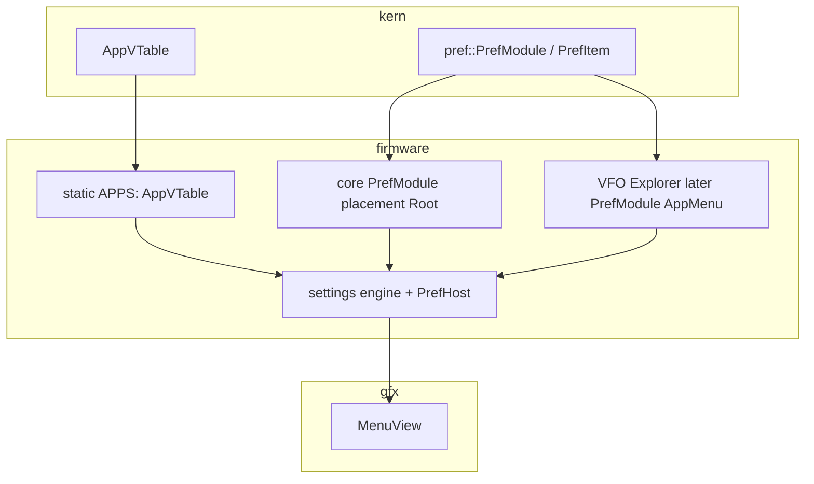

# Prefs framework, then IA (Cortex-M0+)

## Layers (who owns what)

Do not dump menus into gfx or config blobs into the kernel. Three contracts:

| Layer | Owns | Does not own |
| --- | --- | --- |
| **kern** | `App`, `Event`, **`pref` schema**, **`AppVTable<C>`** | Pixels, `BatteryConfig` offsets, ST7565 |
| **gfx** | `MenuItem`, `MenuView`, `OptionSheet` | Preference keys, which app contributed a page |
| **firmware** | Config files, `PrefHost` (read/write/live/action), core Display/Audio/… tables, charging, radio | A second ad-hoc menu language |

Today [`AppRegistry`](src/apps/firmware/src/main.rs) is six `match app_id` copies and settings is two languages ([`DOMAINS`](src/apps/firmware/src/apps/settings/options.rs) vs [`SystemDomain`](src/apps/firmware/src/apps/settings/system.rs)). That is the flash and extensibility tax.



## Kernel: declarative prefs, no callbacks per row

New [`src/kern/src/pref.rs`](src/kern/src/pref.rs) — `Copy`, `'static`, no gfx, no heap:

- `PrefModule { title, placement, items: &'static [PrefItem] }`
- `PrefPlacement::Root` — items land on Settings root (system pages)
- `PrefPlacement::AppMenu` — items land under `title` (usually `AppMetadata.name`)
- `PrefItem { title, kind, key }` with **dense `PrefKey { owner, store, field }`** (three `u8`s)
- `PrefKind`: `Submenu(&'static [PrefItem])`, `Choice(&'static [&str])`, `Range {..}`. `Toggle`, `Live(u8)`, `Action(u8)` — **no `fn` pointers on items**

Live/action are IDs interpreted by the owning app’s host, not closures. That keeps the table in `.rodata` and avoids a Thumb veneer per row.

`App` grows `fn prefs() -> Option<&'static PrefModule> { None }` as documentation; the **source of truth is the vtable field** so apps with no prefs cost **zero extra functions**.

```rust
pub struct AppVTable<C> {
    pub meta: AppMetadata,
    pub prefs: Option<&'static PrefModule>,
    pub on_start: fn(&mut C),
    pub on_event: fn(&mut C, &Event) -> EventResult,
    pub on_modal_result: fn(&mut C, &ModalResult) -> EventResult,
    pub on_exit: fn(&mut C),
    pub render: fn(&mut Canvas, &C), // Canvas stays in kern::canvas already
    pub status_bar: fn(&C) -> StatusBarConfig<'_>,
    pub pref_get: Option<fn(&C, PrefKey) -> PrefValue>,
    pub pref_set: Option<fn(&mut C, PrefKey, PrefValue)>,
    pub pref_live: Option<fn(&C, u8, &mut [u8; 18]) -> u8>, // len
    pub pref_action: Option<fn(&mut C, u8)>,
}
```

Firmware `AppRegistry` becomes `&'static [AppVTable<FirmwareContext>]` — one indirect call, prefs discoverable with `apps[i].prefs`. Adding VFO settings later is a static table + filling those four `Option<fn>` slots, not a new `items_type` in Settings.

`pref_get`/`set` are **once per app**, not per item. Core system stores (display.cfg, …) are `owner = SETTINGS` and handled by one firmware host match on `store` (`CfgId`).

## Flash-first choices (non-negotiable)

- **Delete** the SystemDomain populate/update clone; one engine materializes `PrefItem` → existing `MenuItem`.
- **No per-item function pointers** (largest silent flash killer on M0+).
- **Share** option string tables (`OFF_ON`, `SHORTCUT_OPTIONS`, …).
- Settings paths `#[inline(never)]`; do not monomorphize the engine per app — **one** `PrefHost` in SettingsApp that dispatches `PrefKey.owner` through the vtable.
- Root list is **composed at runtime** from Root modules then AppMenu modules (pointer walk). Do not emit a second combined static copy of every title.
- Do **not** add a separate `prefs` crate (extra rlib / metadata). Schema lives in kern; engine stays in `apps/settings`.
- Do **not** implement VFO/Explorer pages in this pass — only the hook. Empty `prefs: None` is the default.

## Firmware engine

[`apps/settings/`](src/apps/firmware/src/apps/settings/):

- `engine.rs` — stack of `&'static [PrefItem]`, fill `[MenuItem; 16]`, tick-refresh if current slice has `Live`
- `host.rs` — `CfgId` read/write for core config; passcode / owner text as `Action` IDs
- Domain files stay **tables only** (`BUTTONS_ROOT`, `BUTTONS_TWEAKS`, `SHORTCUTS`, …)
- `app.rs` — thin `App` impl + compose root from `AppRegistry` prefs

Rule for other apps: if `prefs` is `Some` and `AppMenu`, Settings root gains a submenu named `meta.name`. System pages use one `CORE` module with `placement: Root`.

## Product IA (core PrefModule)

Root: Display, Audio, **Buttons**, Battery, **Device**, **Security**, System.

### Buttons
Auto Lock, Sticky F-Key, Fast Scroll, Tweaks (Hold Delay, Repeat Rate), Shortcuts. Drop Keypad Light.

Shortcuts: preset combos only (Side 1/2 Short/Long, Menu Long, `F + 1`…`F + 9`). Same action sheet. Sticky F + digit dispatches `keys.f_digit[n]` in the orchestrator. Bump `KeyConfig`.

### Battery
**Capacity**, **Status Bar**, live Voltage, Auto Power Off, Info, Tweaks (mV offset, Charging Detect, Power Profile). Info uses `Live` IDs. Drop System → Power.

### Device
Model, Owner, Asset Tag, Radio ID. Serial/MAC on System.

### Security
Passcode **Set** / **None**. Dimmed (was Stealth). No hashes/SWD here.

### System
Live Serial, MAC, `hal::rcc::sysclk_hz()` (48 vs 72). Nested Storage (`KernFS::stats`), Calibration, Debug (SWD).

## Charging

Unlock/backlight timeout: voltage recovery latches charging. Pass live PWM; load-dump hold-off; stricter rise; Tweaks disable.

## Out of scope

Rewriting task scheduler, radio, or gfx. No filesystem keybind registry.
