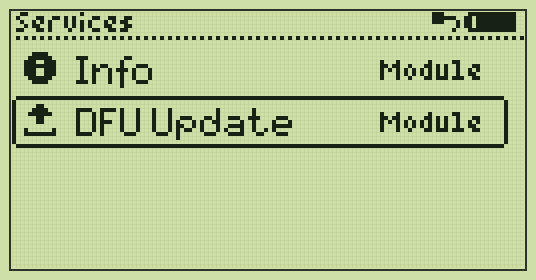
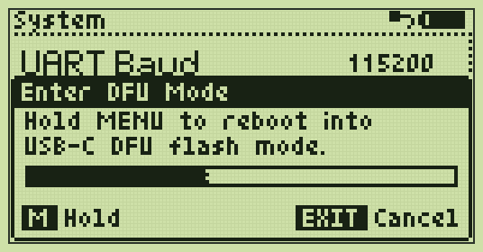
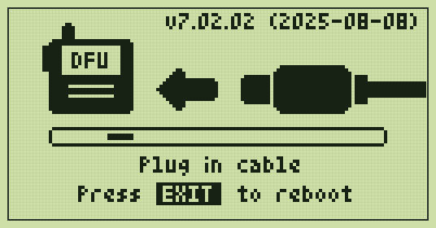
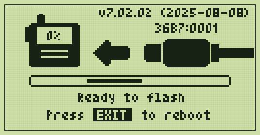
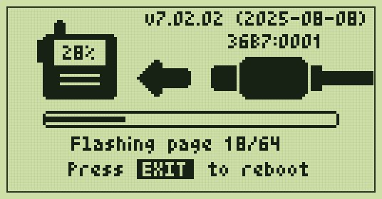
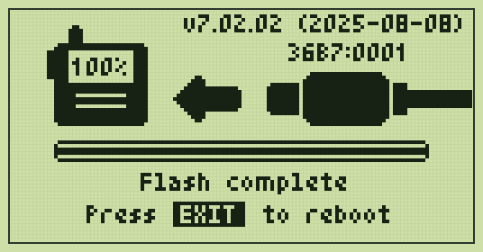

# KERN DFU Update Module (`/apps/dfu.mod`)

A relocatable **P0 Structured Paged (`FLAG_SYSTEM_ACTION`)** KRX system module that provides full USB-C / UART DFU bootloader UI, splash graphics, hardware quiescing, and a live 30 Hz SRAM SysTick telemetry runtime on Quansheng UV-K1 / UV-K5 (`PY32F071xB`) without compiling DFU UI or hook payloads into the main firmware image.

---

## Screenshots

| Services List (`Settings → Apps → Services`) | Hold-Confirm Bottom Sheet (`Settings → System`) |
| :---: | :---: |
|  |  |

| Standby (`Plug in cable`) | USB Enumerated (`Ready to flash`) |
| :---: | :---: |
|  |  |

| Active Flash (`Flashing page 18/64`) | Flash Complete (`100%` / elapsed seconds) |
| :---: | :---: |
|  |  |

---

## Features

- **Dual Entry Paths**:
  - **Cold Boot Chord**: Hold `PTT + Side Key 2` at power-on (`try_launch_boot_module("/apps/dfu.mod")`).
  - **In-OS Settings Action & Service Icon**: Auto-discovered under `Settings → System → DFU Update` via `FLAG_SYSTEM_ACTION`, and listed in `Settings → Apps → Services` with an 8×8 upward upload-arrow icon (`--icon 49`, `ICON_UPLOAD`). Pressing `DFU Update` opens the bottom-sheet **Hold MENU (1 s)** safety confirmation (`leaf2_modal.c`), flushes config, and reboots into DFU.
- **Zero-Allocation Split Leaf Overlay Architecture (P0)**:
  - **Resident Root (`src/dfu.c`, 4,708 B)**: KRX entry dispatch (`_start` / `krx_main`), GPIO/RCC/USB hardware quiescing, `MSP` evacuation to `0x2000_2FC0`, factory bootloader RVCT trampoline verification (`0x0800_0000`), and `VTOR` SRAM handoff.
  - **`leaf1_splash.c` (1,008 B)**: Decompresses the 128×64 PackBits RLE DFU splash (`DFU_SPLASH_RLE`), parses the factory bootloader version (`0x0800_1F00`) + USB ROM descriptor `VID:PID` and build date, and renders the top header line.
  - **`leaf2_modal.c` (266 B)**: Presents the `"Enter DFU Mode"` hold-to-confirm modal inside `Settings → System` and triggers `sys_flush_config()` + bootloader reboot upon confirmation.
  - **`leaf3_stage.c` (773 B)**: Waits cleanly for `PTT` / `Side Key 2` release, renders `"Press [EXIT] to reboot"` and initial status, and stages pre-rendered banners, blink-arrow bitmap, and `VID:PID` label into `g_state` prior to `MSP` evacuation.
- **30 Hz Live SRAM SysTick Telemetry Hook (`src/dfu_hook.S`, 2,124 B)**:
  - **Live Link Detection**: Automatically distinguishes active USB enumeration (`36B7:0001` via `USBD_ADDR` + advancing `USBD_FRAME`), UART activity (`USART1` + `DMA1_Channel2` RX ring, displaying detected baud rate e.g. `115200bps`), and idle standby.
  - **Rich Live Telemetry**:
    - Animates the Page 4 capsule pill (`Standby` / `USB connected` / `Ready to flash` / `UART connected`) and switches to a proportional `0..=100%` progress bar during active flashing (`"Flashing page X/Y"`).
    - Stamps percentage (`0%..100%`) and alternates completion duration (`<N>s`) directly inside the miniature radio LCD cutout (`X=17..=32, Pages 1..2`).
    - Blinks the splash arrow in standby (`~1 Hz`) and pulses USB/UART link activity.
  - **Hardware & Anti-Brick Protection**:
    - Locks `PC13` flashlight low and PTT GPIOs safe before handoff.
    - **Backlight & Exit Controls**: Short-pressing `Side Key 1` toggles backlight (`PF8`); holding `Side Key 1` or `EXIT` (`PB3 + PB15`) for ≥ 0.5 s reboots cleanly after validating firmware vectors (`0x0800_2800..0x0802_0000`).
    - **Mid-Flash Stall Guard**: Detects a 10 s flash stall (`300` ticks @ 30 Hz), switches to `"Aborted - reflash"` with a dashed capsule bar, and blocks accidental reboot away from the bootloader if flash state was interrupted mid-write.

---

## Package Structure

```
packages/dfu/
├── README.md                 # Module documentation and screenshots
├── build.sh                  # Cortex-M0+ PIC build + relocation/size checks + KRX packer
├── dfu.mod                   # Packed P0 Structured Paged module (~6.9 KB, install to /apps/dfu.mod)
├── krx.ld                    # Shared Thumb-1 PIC linker script (.text.entry pinned at offset 0x0)
├── screenshots/              # Rendered ST7565 128x64 UI screenshots
└── src/
    ├── dfu.c                 # Resident root, hardware quiesce & bootloader handoff
    ├── dfu_shared.h          # Shared DfuSharedState & ROM bootloader version helper
    ├── dfu_hook.S            # Position-independent 30 Hz SysTick SRAM runtime hook
    ├── leaf1_splash.c        # Leaf 1: Splash RLE + USB ROM metadata & header
    ├── leaf2_modal.c         # Leaf 2: Settings hold-to-confirm modal
    └── leaf3_stage.c         # Leaf 3: Key-release guard & SRAM asset pre-renderer
```

---

## Memory Map During Bootloader Handoff

| Region | Size | Purpose |
| :--- | :--- | :--- |
| `TRANSIENT_ARENA[0..4708)` | 4,708 B | Resident root (`dfu.c` code, embedded `dfu_hook.bin`, `g_state` staging) |
| `TRANSIENT_ARENA[5120..6144)` | 1,024 B | Shared P0 leaf overlay window (`leaf1_splash` / `leaf2_modal` / `leaf3_stage`) |
| `0x2000_2FC0` (growing down) | — | Evacuated `MSP` used by `handoff_to_factory_bootloader()` before staging copy |
| `0x2000_3000..0x2000_35A8` | 1,448 B | Copied SRAM UI strips (`sram_banners`, `sram_arrow`, `sram_vidpid`) |
| `0x2000_3600..0x2000_36FF` | 256 B | Relocated `VTOR` vector table + hook runtime state (`0x2000_36C0`) |
| `0x2000_3700..0x2000_3FFF` | 2,304 B | Live `dfu_hook.bin` SysTick ISR + 3×5 glyph table (`2,124 B`) |

---

## Build & Verify

```bash
bash packages/dfu/build.sh
```

`build.sh` compiles `src/dfu_hook.S`, `src/dfu.c`, and all three leaves with `-fPIC -fPIE -fvisibility=hidden`, enforces zero undefined symbols, zero ELF relocations, zero `.got` sections, exact `0x00000000` entry offsets, and strict size bounds (`root <= 4900 B`, each leaf `<= 1024 B`), then packs `packages/dfu/dfu.mod` with `--icon 49` (`ICON_UPLOAD`) via [pack_krx.py](../../tools/pack_krx.py).

---

## Sideloading & Installation

Install `packages/dfu/dfu.mod` to `/apps/dfu.mod` on the radio's LittleFS storage using RigWire (over USB-C CDC or UART @ 115200 baud):

```bash
# Recommended: validates KRX header, profile, capabilities, and CRC-32 before & after upload
./kern wire sideload packages/dfu/dfu.mod --force

# Specify serial port explicitly if needed (e.g. /dev/ttyACM0, /dev/ttyUSB0, COM3)
./kern wire -p /dev/ttyACM0 sideload packages/dfu/dfu.mod --force

# Or run RigWire directly and verify the installed file on KernFS
python3 tools/rigwire.py sideload packages/dfu/dfu.mod --force
./kern wire stat /apps/dfu.mod
./kern wire ls /apps
```

> **Note:** Keep the `.mod` filename (do not pass `--name dfu` without `.mod`, which defaults the extension to `.krx`) so the cold-boot `PTT + Side Key 2` launcher resolves `/apps/dfu.mod` directly.

To inspect or remove the module later on the radio, open **Settings → Apps → Services → DFU Update**, or delete via wire:

```bash
./kern wire rm /apps/dfu.mod
```
