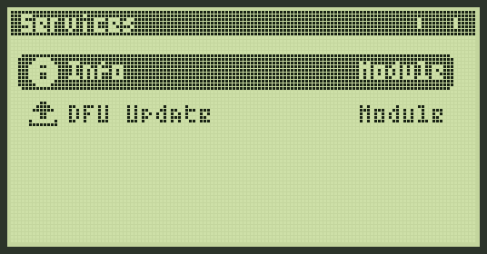
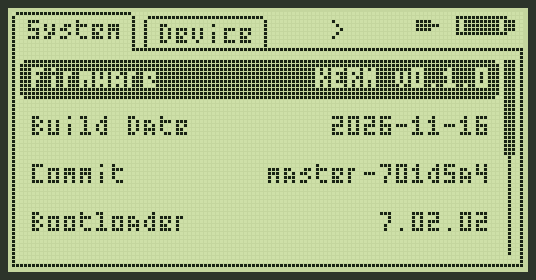
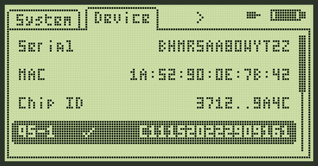
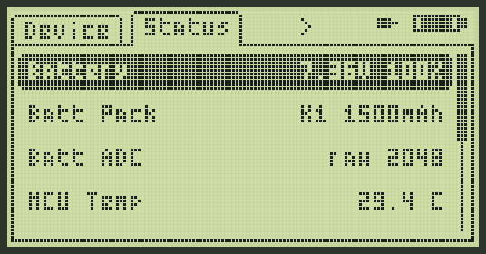
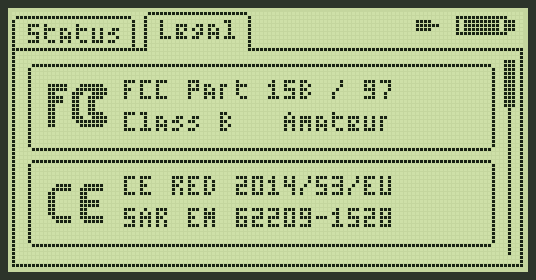
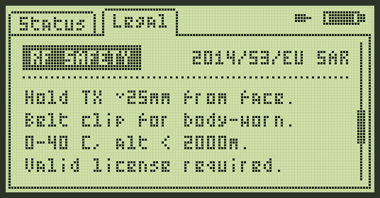

# KERN System Information Module (`/apps/sysinfo.krx`)

A relocatable **P0 Structured Paged (`FLAG_SYSTEM_MENU`)** KRX system module that renders full firmware, hardware identity, live power/thermal telemetry, hardware `QS-1` AES-128-CBC validation, and K1 / K5 V3 regulatory documentation via shared `gfx` widgets (`TabbedSheet`, `ui_draw_menu_item`, `ui_draw_scrollbar`) without bloating the main firmware image.

---

## Screenshots

| Services List (`Settings → Apps → Services`) | `System` Tab (Firmware & Build) |
| :---: | :---: |
|  |  |

| `Device` Tab (Identity & Verified `QS-1`) | `Status` Tab (Live Power & Thermal) |
| :---: | :---: |
|  |  |

| `Legal` Tab (FCC & CE Marks) | `Legal` Tab (RF Safety & SAR) |
| :---: | :---: |
|  |  |

---

## Sections & Information

- **`System`**: Firmware version (`KERN vMAJOR.MINOR.PATCH`), separate **Build Date** (`YYYY-MM-DD`), separate **Commit** (`<branch>-<commit>`), factory **Bootloader** version, **Calibration** authentication status (`Valid` / `(none)`), live **CPU Clock** (`MHz`), and **OS ABI** version.
- **`Device`**: Radio **Model**, **MCU** (`PY32F071xB`), **Memory** (`Flash / RAM`), Crockford hardware **Serial**, EUI-48 **MAC** address, condensed **Chip ID** (`uid[0..2]..uid[10..12]`), and **`QS-1`** provisioning status with a `✓` / `✗` indicator (`<value>` when valid, plus `(none)`, `(empty)`, or `(invalid)`).
- **`Status`** (1 Hz live refresh): **Battery** (`V`, `%`, `CHG`/`LOW`/`CRIT`), **Batt Pack** curve (`1600mAh`..`K1 2500mAh` / `External`), **Batt ADC** raw reading, **MCU Temp** (`C`), **Uptime** (`HH:MM:SS`), and **Stack Free** (`current / min`).
- **`Legal`** (4 scrollable pages): FCC Part 15B / 97 & CE RED `2014/53/EU` (`SAR EN 62209-1528`) marks, `47 CFR 15.19` compliance notice, RF exposure (`~25mm` TX separation, belt clip, `0-40 C`, `< 2000m`), and battery / antenna safety precautions from the Quansheng UV-K1 / K5 V3 manuals.

---

## Architecture & Zero Firmware Bloat

- **Resident Root (`sysinfo.c`, 3,649 B)**: Handles KRX event/render lifecycle (`KRX_OP_START`, `KRX_OP_EVENT`, `KRX_OP_RENDER`, `KRX_OP_EXIT`), queries typed `ServiceApi::sys_info(&KrxSysInfo)` (`128 B`), formats static/live rows, and draws the integrated `86 px` `TabbedSheet` alongside the partial status bar.
- **`leaf1.c` (1,015 B)**: Flash-paged P0 overlay (`< 1 KB`) for the 4-page `Legal` tab with `FCC_BMP` / `CE_BMP` bitmaps and manual statements (with a compact built-in fallback in `sysinfo.c` if `leaf_call` returns non-zero).
- **`leaf2.c` (988 B)**: Flash-paged P0 overlay (`< 1 KB`) invoked once at `KRX_OP_START` to run the stock Quansheng FIPS-197 AES-128-CBC folded-MAC check against `0x0800_2700..0x0800_2767` and the 16-byte MCU UID (`0x1FFF_3000..0x1FFF_300F`) using an algebraic GF(2^8) S-box — keeping **0 bytes** of AES code or lookup tables in main firmware Flash and **0 bytes** in resident `sysinfo` SRAM.

---

## Controls

- **`1` – `4`**: Jump directly to `System`, `Device`, `Status`, or `Legal`.
- **`*` / `#` / `MENU`**: Cycle backward / forward across tabs.
- **`UP` / `DOWN` / Encoder**: Scroll rows or pages inside the active tab.
- **`EXIT`**: Close System Info and restore the full status bar.

---

## Package Structure

```
packages/sysinfo/
├── README.md                 # Module documentation and screenshots
├── build.sh                  # Cortex-M0+ PIC build + 0-reloc/1KB leaf checks + KRX packer
├── krx.ld                    # Shared Thumb-1 PIC linker script
├── leaf1.c                   # Leaf 1: Flash-paged Legal & Regulatory renderer (< 1 KB)
├── leaf2.c                   # Leaf 2: Flash-paged AES-128-CBC QS-1 verifier (< 1 KB)
├── screenshots/              # Rendered ST7565 128x64 UI screenshots
├── sysinfo.c                 # Resident root app & tab views
├── sysinfo.krx               # Packed P0 Structured Paged module (5,816 B, icon ID 30)
└── sysinfo_shared.h          # Shared minimal C helpers (no libc)
```

---

## Build & Install

```bash
./packages/sysinfo/build.sh
./kern wire sideload ./packages/sysinfo/sysinfo.krx --force
```
